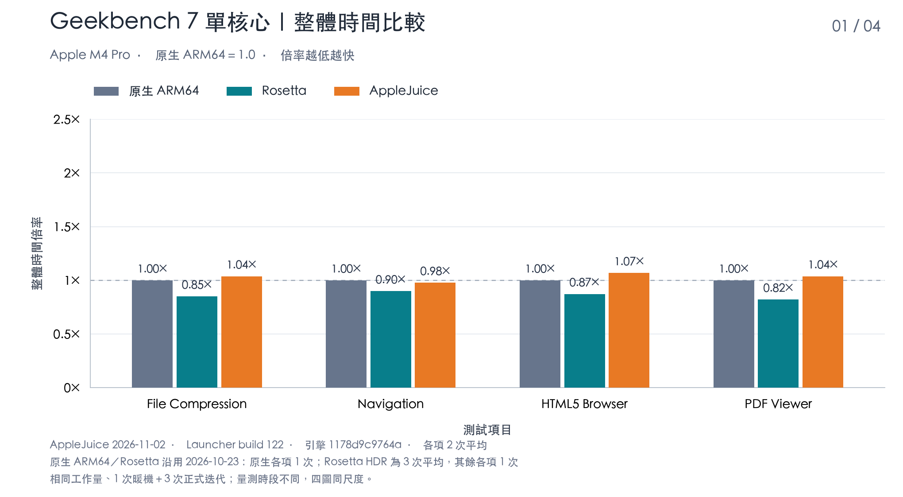
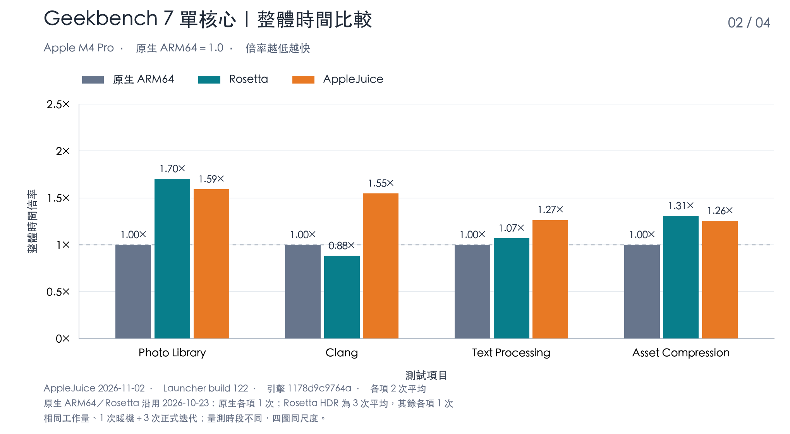
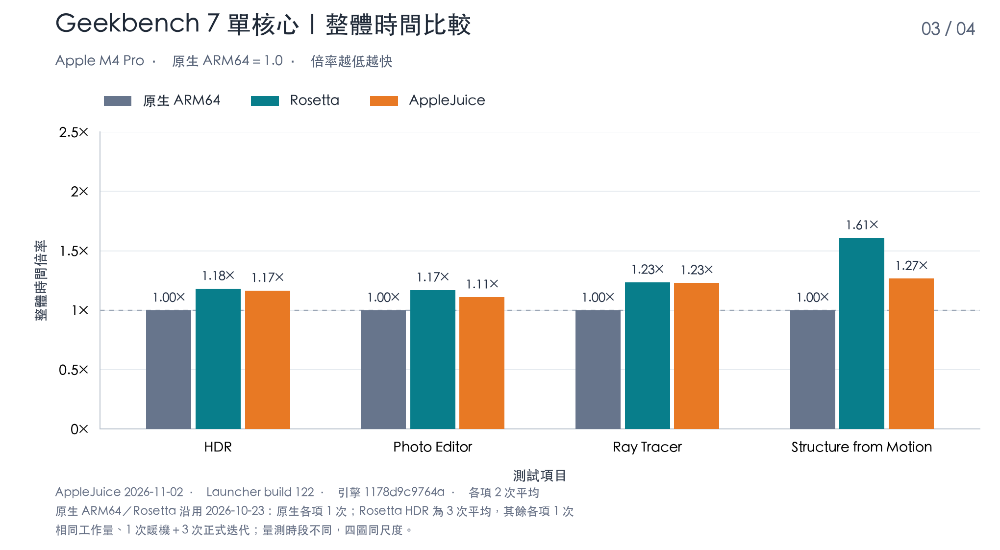
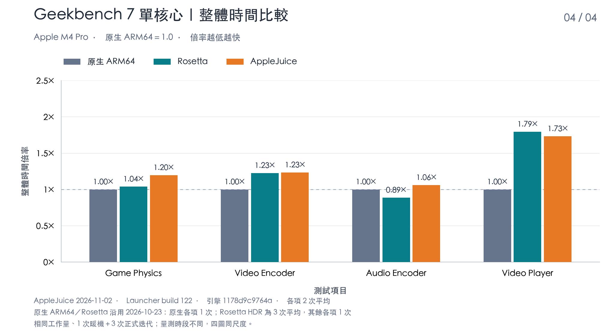
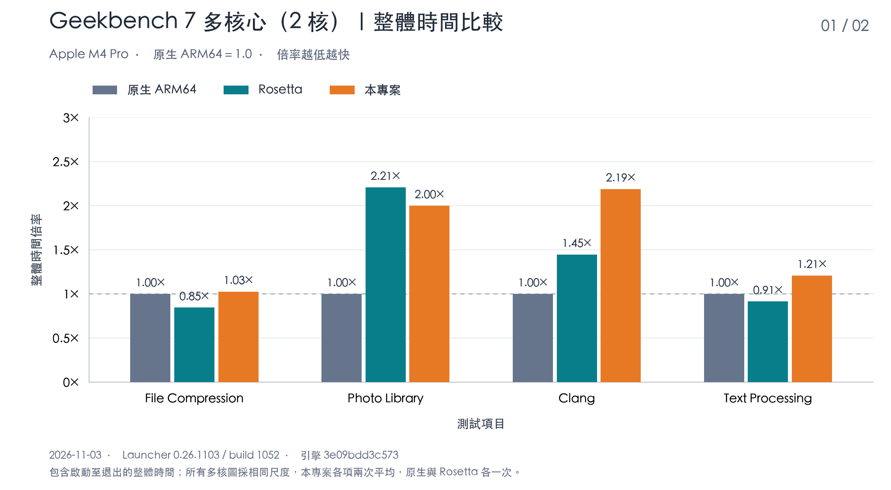
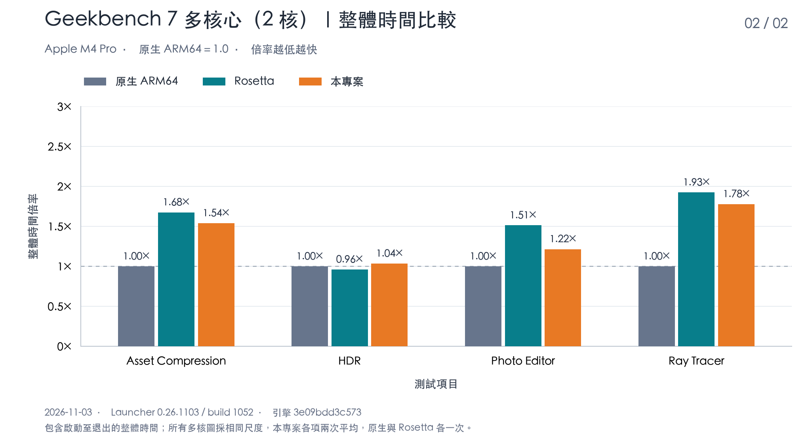
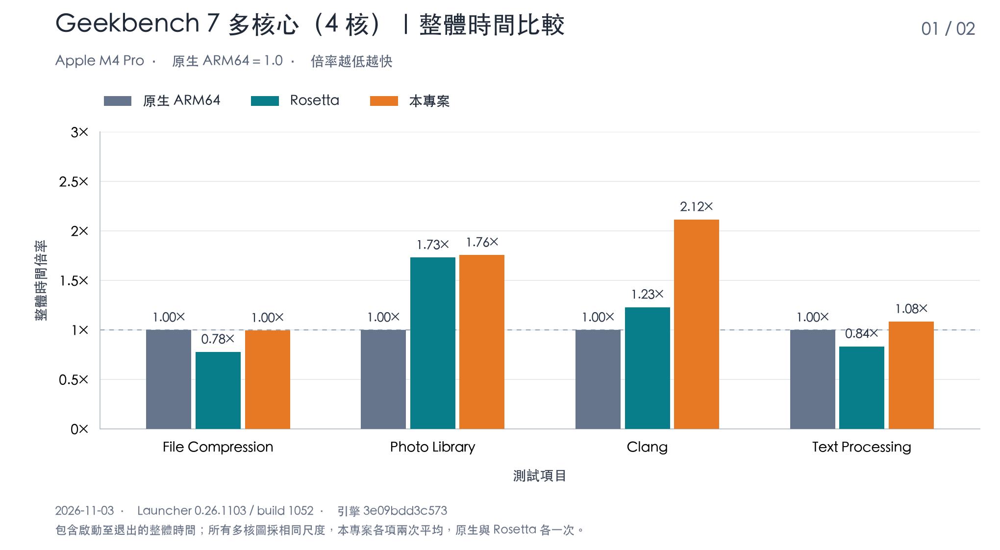
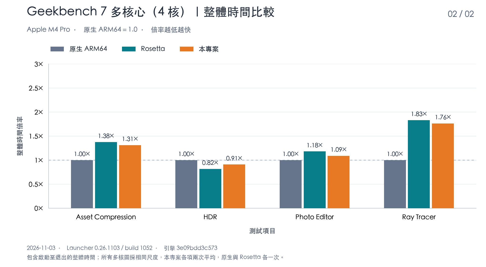

# AppleJuice

[繁體中文](README.md) · [English](README.en.md) · [日本語](README.ja.md) · [한국어](README.ko.md)

AppleJuice runs supported Windows applications on Apple Silicon Macs. It includes the **Win64 Launcher** graphical application and the **x64arm** command-line tool. AppleJuice loads PE/DLL files, provides Windows compatibility services, and connects windows, graphics, audio and input to native macOS interfaces and Metal.

The complete `x64kernel/` static SDK is included; normal builds do not require the kernel source. The kernel is provided separately by AppleJuiceKernel. Statically linked executables and Launcher bundles are distributable AppleJuice products, with the applicable licenses retained.

## Project goals and features

- **No Windows system files required:** Run supported applications without installing Windows or supplying Windows system DLLs. Users provide their applications and bundled dependencies.
- **Prefer native ARM64 instructions:** Preserve x86/x64 instruction semantics and application behavior while using Apple Silicon's native ARM64 instructions and NEON vector operations wherever possible.
- **Use native hardware acceleration:** Prefer Metal for graphics and GPU compute, and use native macOS frameworks and available hardware acceleration for workloads such as video processing.

## Geekbench 7 single-core total elapsed time

The 16 single-core workloads in Geekbench 7.0.0 Pro (build 703423) were measured on November 2, 2026, on an Apple M4 Pro with 64 GiB of memory and macOS 27.0.1, using AppleJuice Launcher 0.26.1102 (build 122). The native ARM64 and Rosetta figures are from the October 23, 2026 measurement. All runs were sequential, with one core per process, one warm-up and three measured iterations; the official workload is identical across all three for every workload.

**Each workload's native ARM64 total elapsed time is normalized to 1.0; lower ratios are faster.** Total elapsed time runs from process start to exit and includes initialization, calibration, warm-up, the measured workload and result writing within the process. It excludes the measurement tool's input preparation, idle waiting and cleanup after exit. All four charts use the same Y-axis scale, with four workloads per chart.

AppleJuice runs the Windows x86_64 version, Rosetta runs the macOS x86_64 version, and native execution uses the macOS ARM64 version. AppleJuice values are the arithmetic mean of all valid runs: two per workload, 32 in total. Native ARM64 used one run per workload; Rosetta HDR is the mean of three runs and every other workload used one run. Measurement times and sample counts differ and include external load, so the charts show measured results without claiming statistical significance. Total elapsed time is taken directly from measurement; no compute-efficiency adjustment is applied.

Before starting the tests, the native ARM64 version spends about 4.6 seconds collecting system information, versus about 1.6 seconds for Rosetta. As a result, Rosetta's total elapsed time is shorter than native for some workloads, while the measured compute time is fastest natively for every workload.

**Clang progress update:** AppleJuice's total elapsed time dropped from **17.96 s to 12.83 s, 28.56% shorter**, and its ratio to native went from **1.55× to 1.11×**. This figure is the mean of four valid measured runs of the build adopted so far; only the AppleJuice Clang bar was updated, and the native/Rosetta baselines and other workloads keep their original data.









## Geekbench 7 multi-core total elapsed time

On November 3, 2026, on the same Apple M4 Pro (macOS 27.0.1), the 8 workloads that Geekbench 7.0.0 Pro (build 703423) officially offers in multi-core mode were measured with Launcher 0.26.1103 (build 1052, the GitHub Release build), once with 2 cores and once with 4 cores. All three use the same worker count, one warm-up and three measured iterations, and the official workload is identical for every workload. For each core count, native ARM64, Rosetta and AppleJuice were measured interleaved in the same session.

The method matches the single-core charts: **each workload's native ARM64 total elapsed time is normalized to 1.0; lower ratios are faster.** Total elapsed time runs from process start to exit. The four charts for 2 and 4 cores share the same Y-axis scale, with four workloads per chart.

AppleJuice values are the arithmetic mean of two runs per workload; native ARM64 and Rosetta used one run each. Each of the three ran one warm-up before measurement, which is not counted. Other programs were running on the host during measurement; results where host load rose sharply during a run because of other work were excluded and measured again. The charts show measured results without claiming statistical significance.

As in the single-core results, the native ARM64 version spends longer collecting system information, so Rosetta's total elapsed time is shorter than native for File Compression, Text Processing and HDR, while the measured compute time is fastest natively for every workload.

**Clang progress update:** Re-measured with the same adopted build as the single-core progress chart, the 2-core total elapsed time dropped from **90.54 s to 79.34 s, 12.37% shorter**, and the 4-core time from **55.33 s to 50.15 s, 9.37% shorter**. The ratios to native went from **2.19× to 1.92×** and from **2.12× to 1.92×** respectively. For each core count, one warm-up process ran first, followed by the mean of two valid measured processes; each process ran one warm-up and three measured iterations with 8 GiB of guest memory. Only the AppleJuice Clang bars were updated; the other workloads and the native/Rosetta baselines keep their original data. The old and new measurements were taken at different times and the new runs included background guest load; no builds or separate probes were detected interfering, and no claim of statistical significance is made.









## Getting started

Requirements: an Apple Silicon Mac, Xcode Command Line Tools, CMake 3.24+, Ninja, Python 3, Perl, make, Go 1.23+ and MinGW x64 GCC (`x86_64-w64-mingw32-gcc`). Frontend assets are included; normal builds do not need Node.js. The first Go build requires network access or a populated module cache.

Run this from the repository root, or double-click `run.command` in Finder:

```sh
./run.command
```

After the build, `build/launcher/Win64 Launcher.app` opens. Click “Add EXE”, select a Windows application you provide, configure its working directory, command line, drive mappings and write permission, then click Play. Console applications use the embedded terminal; graphical applications open separate windows.

## Build from source

```sh
cmake --preset release
cmake --build --preset release --target x64arm --parallel 4
./build/release/x64arm doctor
python3 scripts/build_launcher.py --jobs 4
```

The first three lines build and check the CLI; the last line builds and packages Launcher. Keep the SDK's headers, static libraries, CMake configuration and licenses together, and do not mix versions. Pinned third-party sources and licenses are also included.

## Documentation and compatibility

[Getting started](docs/getting-started.md) · [Launcher](docs/launcher.md) · [Build and packaging](docs/build-and-release.md) · [Execution and compatibility](docs/realworld-support.md) · [GPU memory](docs/gpu-memory.md) · [Geekbench instructions](docs/geekbench7-single-core.md) · [Documentation index](docs/README.md)

Detailed usage documents are currently in Traditional Chinese. x64 OpenCL and Vulkan use macOS OpenCL.framework and a Vulkan loader/MoltenVK respectively; see [OpenCL/Vulkan](docs/opencl-vulkan-support.md) for requirements and limitations.

### CPU and multi-core

Both 32-bit and 64-bit applications use resident AOT by default. Launcher can set the guest CPU core count per application, and multiple guest threads run in parallel on resident workers. Measured on November 2, 2026 with the eight official Geekbench 7 multi-core workloads, scaling relative to the single-core baseline is 1.79–2.18× with 2 cores and 2.84–4.35× with 4 cores.

### Direct3D 9

Provides D3D9/D3D9Ex devices, textures and buffers, fixed-function and programmable drawing, swap chains and presentation through Metal. Special formats, device capabilities and combinations of render states still have compatibility limits.

### Direct3D 10/10.1

Provides D3D10/D3D10.1 devices, resources, shaders, drawing and DXGI swap chains through Metal. Successful device creation or a version number does not establish support for every feature or format.

### Direct3D 11

Provides devices and contexts, resources and views, DXBC shader translation, Draw/Dispatch and DXGI presentation, covering graphics and GPU compute paths. D3D11.1–11.4 interfaces are routed through the same processing path, and shaders can be translated in the background. Advanced features, formats and extended interfaces depend on the application's requirements; a reported feature level does not establish complete 11.x compatibility.

### Direct3D 12

Provides a subset of devices, command queues/lists, resources and descriptors, root signatures, graphics/compute, fences and DXGI presentation through Metal, with command lists replayed on a dedicated submission thread. Indirect commands and Bundles have execution paths; advanced features such as DXR, Mesh Shaders and Work Graphs are outside the complete-compatibility commitment.

### x86 (32-bit Windows)

Alongside x86_64 (64-bit), x86 PE32 executables and matching DLLs can be loaded. Both 32-bit and 64-bit applications use resident AOT by default. Bundled DLLs must match the EXE's bitness; a process cannot mix 32-bit and 64-bit DLLs. x86 API and graphics coverage may differ from x64, and this does not establish complete support for WOW64, 16-bit applications, kernel drivers or DRM.

See [Direct3D and x86 compatibility](docs/direct3d-and-x86.md) for details and usage guidance (Traditional Chinese).

### Other APIs

- **OpenGL/WebGL**: OpenGL/WGL renders through Metal by default and falls back to macOS OpenGL if initialization fails; EGL/GLES used by WebGL is handled by ANGLE's Metal backend.
- **Audio**: DirectSound (including 3D positioning and capture), XAudio2, WASAPI and X3DAudio output through Core Audio, preserving stereo left/right channels and panning.
- **Input**: DirectInput (including force feedback), XInput and Raw Input use data from physical input devices on macOS.
- **Video**: H.264 encoding and decoding through Media Foundation and D3D11 DXVA use VideoToolbox hardware acceleration; HEVC and AV1 are not yet complete.

AppleJuice is under active development. Complete Windows support, all applications and all API parameter combinations are not fully supported. Loading a program or opening a window does not establish full application compatibility. Drive mappings are not a complete OS sandbox; enabled services may access mapped files or use the network. Run trusted programs and configure access permissions as needed.

The repository includes `src/`, `include/`, `launcher/`, `cmake/`, required build scripts, `third_party/`, `x64kernel/` and user documentation.

## Tested applications (October–November 2026)

 Does not work yet; being worked on ·  Launches to the main screen ·  Works, with limited performance ·  Works well

| Application | x64/x86 | Core technology | Support level |
| --- | --- | --- | :---: |
| 7-Zip | x64 | Win32 GUI |  |
| DRAGON QUEST III HD-2D Remake | x64 | D3D11 (Unreal Engine 4) |  |
| Geekbench 7 | x64 | CPU |  |
| Memelis' RPG | x86 | RPG Maker MV |  |
| 艾莉露在异世界的冒险之不死之冠 | x86 | RPG Maker MV |  |
| 不谙世事的猫艾露莎 | x86 | RPG Maker MV |  |
| 永恒的黄昏 | x86 | RPG Maker MV |  |
| FINAL FANTASY VIII | x86 | D3D9 |  |
| FINAL FANTASY IX | x64 | D3D9 (Unity) |  |
| Phoenix Wright: Ace Attorney Trilogy | x86 | D3D11 (Unity) |  |
| Sakuna: Of Rice and Ruin | x64 | D3D11 |  |
| Cyberpunk 2077 | x64 | D3D12 |  |
| It Takes Two | x64 | D3D11 (Unreal Engine 4) |  |
| Romance of the Three Kingdoms X with Power Up Kit | x86 | Unknown |  |
| Steam | x64 | Chromium (CEF) |  |
| 小涵的暑假 | x64 | RPG Maker MV |  |
| 勇者的粉色育女日记 | x64 | RPG Maker MZ |  |
| DAVE THE DIVER | x64 | D3D11 (Unity) |  |
| Signal Force | x86 | RPG Maker MV |  |
| Clair Obscur: Expedition 33 | x64 | D3D12 (Unreal Engine 5) |  |

Test records reflect the version and settings at the time and do not establish that complete gameplay, other versions or all settings work.

## Support development

If AppleJuice is useful to you, consider buying me a coffee to support continued development.

[☕ Buy Me a Coffee](https://buymeacoffee.com/vaderchen)

## License

Copyright (C) 2026 VaderChen.

AppleJuice's original content, including the x64arm engine and Win64 Launcher, uses the [source-available, no-commercial-sales license](LICENSE.en.md). Non-sale use, modification and free sharing, including internal business use, are permitted. Software sales, paid hosting/SaaS, paid services and integration into paid products are prohibited. Ordinary employee wages are not considered selling; advertising, referral commissions and user-data monetization through provision of the Software are also restricted. Contact the copyright holder for a separate written license where needed; an inquiry does not grant permission.

Statically linked AppleJuiceKernel executables and Launcher bundles are also distributable AppleJuice products. Retain the kernel and third-party notices with the products; separate repositories do not change the existing license restrictions.

This is a custom source-available license and does not claim to meet the OSI Open Source Definition. READMEs are summaries; the complete Traditional Chinese license governs. Third-party components, separately licensed content and external Windows programs retain their own licenses.

Full license: [繁體中文](LICENSE.md) · [English](LICENSE.en.md) · [日本語](LICENSE.ja.md) · [한국어](LICENSE.ko.md)

[Commercial sales policy](COMMERCIAL-LICENSE.md) · [Scope and source record](docs/licensing.md) · [Third-party notices](THIRD-PARTY-NOTICES.md)
