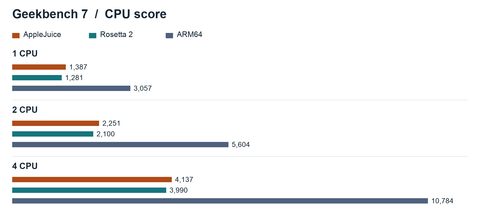
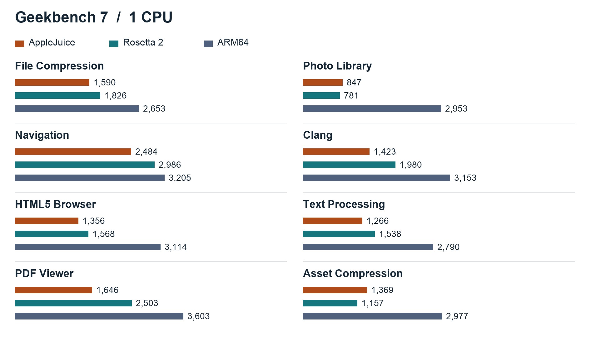
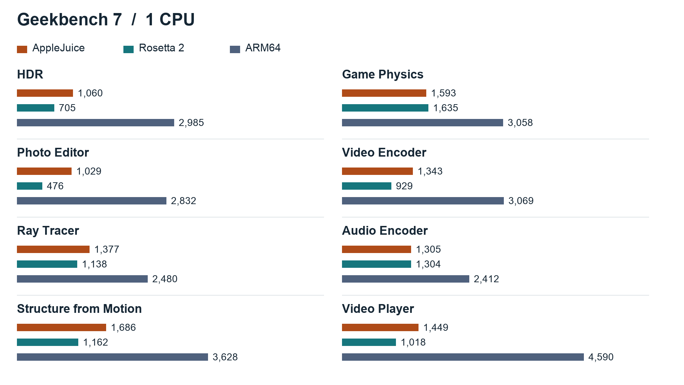
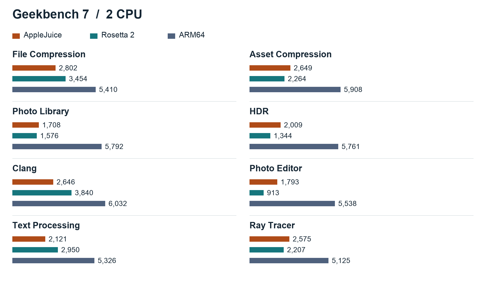
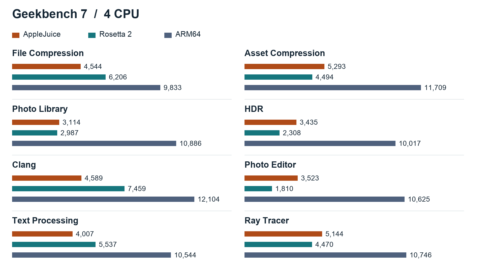

# AppleJuice

[繁體中文](README.md) · [English](README.en.md) · [日本語](README.ja.md) · [한국어](README.ko.md)

AppleJuice は、Apple Silicon Mac 上で対応する Windows アプリケーションを実行する互換性プロジェクトです。GUI の **Win64 Launcher** とコマンドラインツール **x64arm** を提供します。PE／DLL の読み込みと Windows 互換サービスを担い、ウィンドウ、描画、音声、入力を macOS のネイティブインターフェイスと Metal に接続します。

配布版の最低要件は **Apple Silicon、macOS 13.0 以降**です。フレーム補間のみ **macOS 26 以降**と対応デバイスが必要です。非対応の場合は補間を無効にし、通常の実行、MetalFX 拡大、空間音声のために macOS 27 への更新を要求しません。

完全な `x64kernel/` 静的 SDK を同梱しており、通常のビルドにカーネルのソースは不要です。カーネルは別の AppleJuiceKernel で提供します。静的リンクした実行ファイルと Launcher パッケージも AppleJuice の配布対象であり、適用されるライセンスを保持する必要があります。

## 目標と特徴

- **Windows システムファイルを不要にする**：Windows のインストールや Windows システム DLL の提供なしに、対応するアプリケーションを実行することを目指します。アプリケーションと付属の依存ファイルは利用者が用意します。
- **ネイティブ ARM64 命令を優先する**：x86／x64 命令の意味とアプリケーションの動作を保ちながら、Apple Silicon の ARM64 命令と NEON ベクトル演算を可能な限り使用します。
- **ネイティブのハードウェアアクセラレーションを使う**：描画と GPU 計算には Metal を優先し、動画処理などには macOS のフレームワークと利用可能なハードウェア支援を活用します。

## Geekbench 7 CPU スコア

2026年11月25日、同じ Apple M4 Pro（64 GB、macOS 27.2.1）で Geekbench 7.0.0 Pro（build 703423）を測定しました。AppleJuice では Launcher 0.26.1125（build 1313）で Windows x86_64 版を、Rosetta 2 では macOS x86_64 版を、ネイティブ環境では macOS ARM64 版を実行しました。

各環境で CPU 構成ごとに全項目を1回測定し、各項目はウォームアップ1回、計測3回としました。グラフの値は Geekbench が出力した公式スコアで、高いほど高速です。1 CPU はシングルコアの16項目、2 CPU と 4 CPU はマルチコア対応の8項目です。CPU 数は各項目で実際に使用したワーカースレッド数です。

| CPU 構成 | AppleJuice | Rosetta 2 | ネイティブ ARM64 |
|---:|---:|---:|---:|
| 1 CPU | 1,387 | 1,281 | 3,057 |
| 2 CPU | 2,251 | 2,100 | 5,604 |
| 4 CPU | 4,137 | 3,990 | 10,784 |



### 項目別スコア









## はじめに

Apple Silicon Mac、Xcode Command Line Tools、CMake 3.24 以降、Ninja、Python 3、Perl、make、Go 1.23 以降、MinGW x64 GCC（`x86_64-w64-mingw32-gcc`）を用意してください。フロントエンドのリソースは同梱されており、通常のビルドに Node.js は不要です。初回の Go ビルドにはネットワーク接続またはモジュールキャッシュが必要です。

リポジトリのルートで実行するか、Finder で `run.command` をダブルクリックします。

```sh
./run.command
```

ビルド後に `build/launcher/Win64 Launcher.app` が開きます。「EXE を追加」から用意した Windows アプリケーションを選び、作業フォルダ、コマンドライン、ドライブマッピング、書き込み権限を設定して再生ボタンを押します。コンソールアプリケーションは内蔵ターミナルを、GUI アプリケーションは独立したウィンドウを使用します。

## ソースからビルド

```sh
cmake --preset release
cmake --build --preset release --target x64arm --parallel 4
./build/release/x64arm doctor
python3 scripts/build_launcher.py --jobs 4
```

最初の 3 行で CLI をビルドして確認し、最後の行で Launcher をビルドしてパッケージ化します。SDK のヘッダー、静的ライブラリ、CMake 設定、ライセンスを一式で保持し、異なるバージョンを混在させないでください。固定された第三者ソースとライセンスも同梱しています。

## ドキュメントと互換性

[はじめに](docs/getting-started.md) · [Launcher の操作](docs/launcher.md) · [ビルドとパッケージ化](docs/build-and-release.md) · [実行と互換性](docs/realworld-support.md) · [GPU メモリ](docs/gpu-memory.md) · [Geekbench の実行方法](docs/geekbench7-single-core.md) · [ドキュメント一覧](docs/README.md)

詳細な使用ドキュメントは現在、繁体中国語で提供しています。x64 OpenCL は macOS OpenCL.framework、Vulkan は Vulkan loader／MoltenVK を使用します。要件と制限は [OpenCL／Vulkan](docs/opencl-vulkan-support.md) を参照してください。

### CPU とマルチコア

32／64 ビットのアプリケーションは既定で resident AOT を使用します。Launcher ではアプリケーションごとにゲストの CPU コア数を設定でき、複数のゲストスレッドを常駐 worker で並行実行します。2026 年 11 月 2 日に Geekbench 7 の公式マルチコア 8 項目で測定した結果、単一コアの基準に対して 2 コアで 1.79～2.18 倍、4 コアで 2.84～4.35 倍でした。

### Direct3D 9

D3D9／D3D9Ex のデバイス、テクスチャとバッファ、固定機能とプログラマブル描画、スワップチェーン、Metal による表示を提供します。特殊な形式、デバイス機能、描画状態の組み合わせには互換性の制限があります。

### Direct3D 10／10.1

D3D10／D3D10.1 のデバイス、リソース、シェーダー、描画、DXGI スワップチェーンを Metal に接続します。デバイスの作成成功やバージョン番号だけで、すべての機能や形式への対応を判断することはできません。

### Direct3D 11

デバイスとコンテキスト、リソースとビュー、DXBC シェーダー変換、Draw／Dispatch、DXGI 表示を提供し、描画と GPU 計算の経路を含みます。D3D11.1～11.4 のインターフェイスは同じ処理経路に接続し、シェーダーはバックグラウンドで変換できます。高度な機能、形式、拡張インターフェイスはアプリケーションの要件に応じて確認が必要です。feature level の表示は 11.x 全体の互換性を示しません。複数 vCPU では、戻り値のないメソッドをコマンドストリーム経由で専用スレッドが順に実行し、描画スレッドの待ちを減らします（`X64ARM_D3D11_STREAM=0` で無効）。

### Direct3D 12

デバイス、コマンドキュー／リスト、リソースと記述子、ルートシグネチャ、描画／計算、fence、DXGI 表示の一部を Metal で実行し、コマンドリストは専用の送信スレッドで再生します。間接コマンドと Bundle の実行経路がありますが、DXR、Mesh Shader、Work Graph などの高度な機能について完全な互換性は保証しません。

### x86（32 ビット Windows）

x86_64（64 ビット）に加えて、x86 PE32 の EXE と対応する DLL を読み込めます。32／64 ビットとも既定で resident AOT を使用します。付属 DLL のビット数は EXE と一致させる必要があり、同一プロセスで 32／64 ビット DLL を混在させることはできません。API や描画機能の対応範囲は x64 と異なる場合があり、完全な WOW64、16 ビットアプリケーション、カーネルドライバー、DRM への対応を示すものではありません。

詳細と使用上の案内は [Direct3D と x86 の互換性](docs/direct3d-and-x86.md)（繁体中国語）を参照してください。

### その他の API

- **OpenGL／WebGL**：OpenGL／WGL は既定で Metal で描画し、初期化に失敗した場合は macOS の OpenGL を使用します。WebGL が使う EGL／GLES は ANGLE の Metal バックエンドで処理します。
- **オーディオ**：DirectSound（3D 定位と録音を含む）、XAudio2、WASAPI、X3DAudio を Core Audio で出力し、ステレオの左右チャンネルとパンを保持します。
- **入力**：DirectInput（フォースフィードバックを含む）、XInput、Raw Input は macOS の物理入力デバイスのデータを使用します。
- **動画**：Media Foundation と D3D11 DXVA の H.264 エンコード／デコードは VideoToolbox のハードウェアアクセラレーションを使用します。Windows Media（ASF）の VC-1／WMV と WMA は内蔵のデコーダー専用 FFmpeg でデコードします。HEVC と AV1 は未完成です。

AppleJuice は開発中です。Windows 全体、すべてのアプリケーション、すべての API 引数の組み合わせには対応していません。読み込みやウィンドウの表示が成功しても、アプリケーション全体の互換性を保証するものではありません。ドライブマッピングは完全な OS サンドボックスではなく、有効なサービスはマッピング先のファイルやネットワークにアクセスする場合があります。信頼できるプログラムだけを実行し、必要に応じてアクセス権を設定してください。

リポジトリには `src/`、`include/`、`launcher/`、`cmake/`、必要なビルドスクリプト、`third_party/`、`x64kernel/` と使用ドキュメントを含みます。

## ネイティブ MetalFX とマルチチャンネル HRTF ヘッドフォン再生

これらは AppleJuice が画面表示と音声出力の処理でネイティブに提供する機能です。ゲーム自体が MetalFX や HRTF に対応していなくても、ゲームの変更や MOD の導入なしで手動で有効にできます。

### MetalFX アップスケーリングとフレーム補間

- **2 倍拡大表示**：メイン画面のスイッチから、macOS ネイティブの MetalFX 空間アップスケーラーで出力を 2 倍に拡大します。ゲーム側の対応は不要です。
- **フレーム補間**：本プロジェクトが別途 macOS ネイティブの VideoToolbox を使い、完成した前後の画像から中間画像を生成します。ゲームから深度やモーションベクトルを受け取る必要はありません。macOS 26 以降と対応デバイスが必要で、入力は最大 1920×1080 です。ゲーム自体の更新頻度は増えません。
- **ゲーム内 XeSS**：ゲームが XeSS を提供する場合は MetalFX テンポラルアップスケーリングへ変換できます。この経路では Launcher のフレーム補間と 2 倍拡大を自動的に停止し、ゲームのアップスケーラーの出力を表示します。

### マルチチャンネル HRTF ヘッドフォン再生

「ヘッドフォン空間ミックス」を有効にすると、5.1、7.1 などの各チャンネルを仮想スピーカーの位置に配置し、HRTF により通常のヘッドフォン向けのバイノーラル・ステレオへ変換します。低音チャンネルも保持します。ゲームや動画アプリに HRTF 対応は不要ですが、空間効果は実際の入力チャンネル情報によって変わります。

メイン画面と「設定 → オーディオ」に連動するスイッチがあります。初期設定はオフで、変更はアプリの次回起動時に適用します。現在はヘッドトラッキングを使用しません。

### Steam などのランチャーからゲームを起動する

AppleJuice で Steam を選択し、ヘッドフォン空間ミックス、2 倍拡大表示、フレーム補間を設定してから Steam でゲームを起動します。新しいゲームとその子プロセスは最新設定を読み込むため、スイッチ変更後に Steam を再起動する必要はありません。実行中のゲームには、ゲームの再起動後に画面・音声設定を適用します。

AppleJuice のライブラリに登録したゲームは、EXE ごとの表示設定を優先します。未登録のゲームはランチャーの現在の表示設定を引き継ぎます。空間音声は全体設定です。同じ処理を他のランチャーにも適用し、ゲーム名による例外は設けません。

## 動作確認の記録 / 2026-11-25 / 全 37 本のゲーム

-  良好：26
-  良好（MetalFX）：5
-  低効率：12
-  起動可：2
-  動作不可・対応中：2

**[一覧を見る（言語切り替え・対応状況別タブ）](https://vaderchen.github.io/AppleJuice/tested/?lang=ja)**

「良好（MetalFX）」は、Launcher のフレーム補間または 2 倍拡大（MetalFX）を有効にすると「良好」の基準を満たすことを示します。無効の場合は「低効率」です。

DEATH STRANDING DIRECTOR'S CUT は現在「起動可」です。第 3 章のセーブ読込とキャラクター移動は確認済みですが、白いちらつきが発生する場合があり、安定した 50 FPS には達していません。問題を解決し、実際のプレイと他の場面の検証を終えた後に評価を更新します。「良好」は安定して 50 FPS を超えるか、アプリ自身のフレームレート上限に達することを基準とします。

記録は当時のバージョンと設定によるもので、ゲーム全体の流れ、他のバージョン、すべての設定での動作を示すものではありません。

## 開発を支援

AppleJuice が役に立ったら、コーヒー一杯で継続的な開発を応援していただけると嬉しいです。

[☕ Buy Me a Coffee](https://buymeacoffee.com/vaderchen)

## ライセンス

Copyright (C) 2026 VaderChen.

x64arm エンジンと Win64 Launcher を含む AppleJuice の自作部分には、[ソース公開・商業販売禁止ライセンス](LICENSE.ja.md)を適用します。企業内利用を含む非販売の利用、変更、無料共有を許可します。ソフトウェア販売、有料ホスティング／SaaS、有料サービス、有料製品への統合は禁止します。従業員の通常の給与は販売とみなしませんが、ソフトウェア提供による広告収入、紹介報酬、利用者データの収益化も制限します。必要な場合は著作権者と別途書面による許諾をご相談ください。問い合わせだけでは許諾になりません。

AppleJuiceKernel を静的リンクした実行ファイルと Launcher パッケージも AppleJuice の配布対象です。製品にはカーネルと第三者のライセンス表示を保持してください。リポジトリの分離によって既存のライセンス制限は変わりません。

独自のソース公開ライセンスであり、OSI のオープンソース定義に適合すると主張しません。README は要約です。繁体中国語の全文を正本とし、第三者コンポーネント、別途ライセンスの内容、外部 Windows プログラムには各自のライセンスを適用します。

ライセンス全文：[繁體中文](LICENSE.md) · [English](LICENSE.en.md) · [日本語](LICENSE.ja.md) · [한국어](LICENSE.ko.md)

[商業販売ポリシー](COMMERCIAL-LICENSE.md) · [適用範囲と出典](docs/licensing.md) · [第三者ライセンス](THIRD-PARTY-NOTICES.md)
