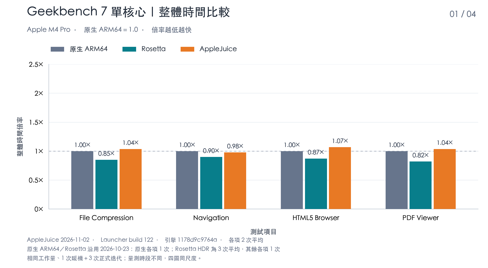
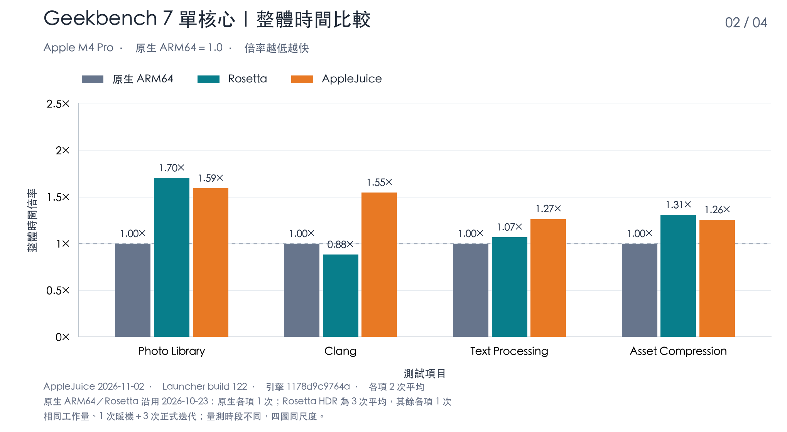
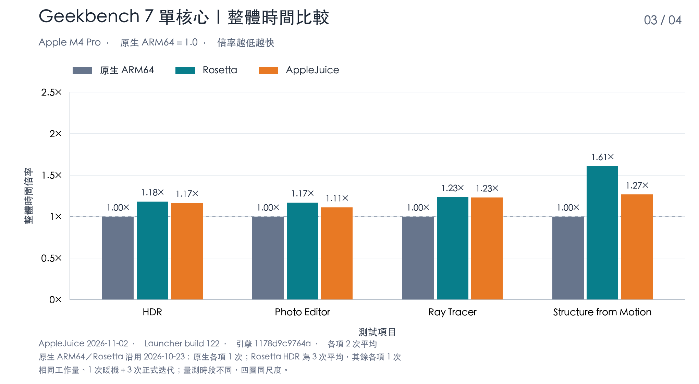
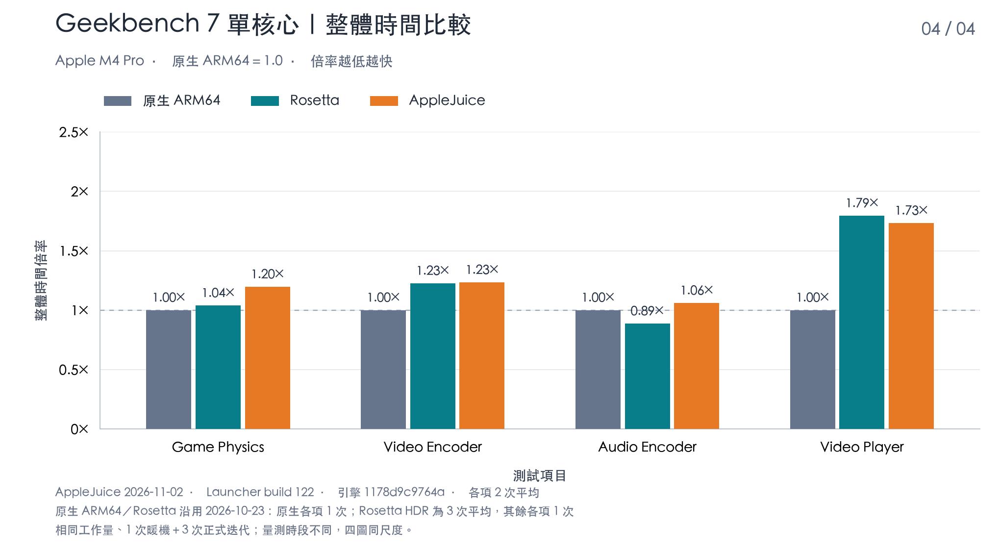
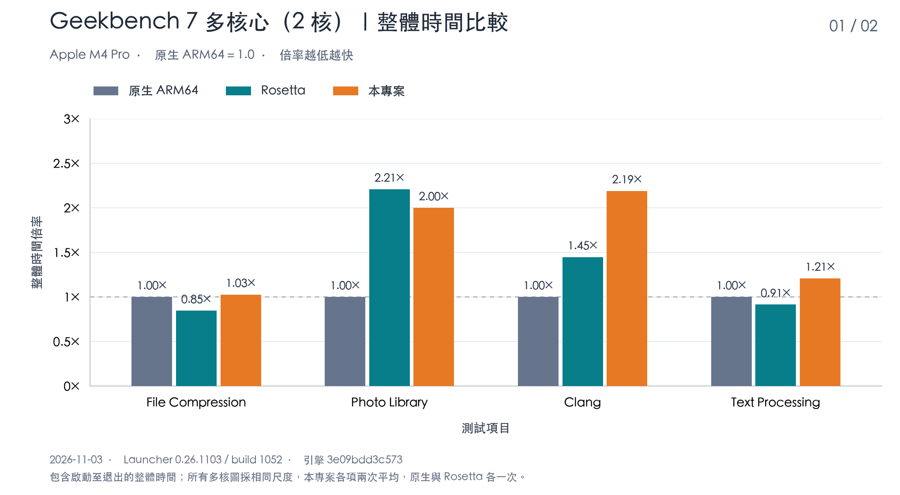
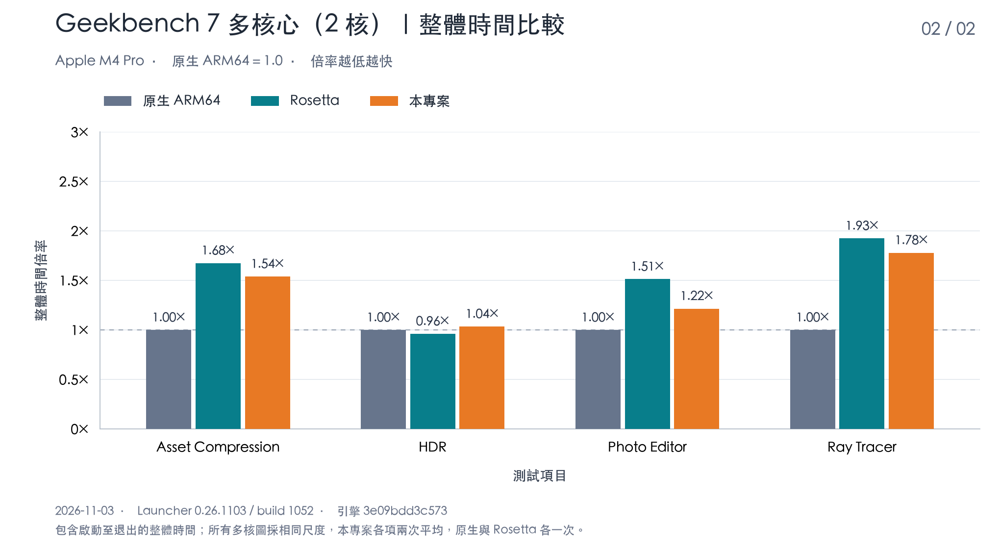
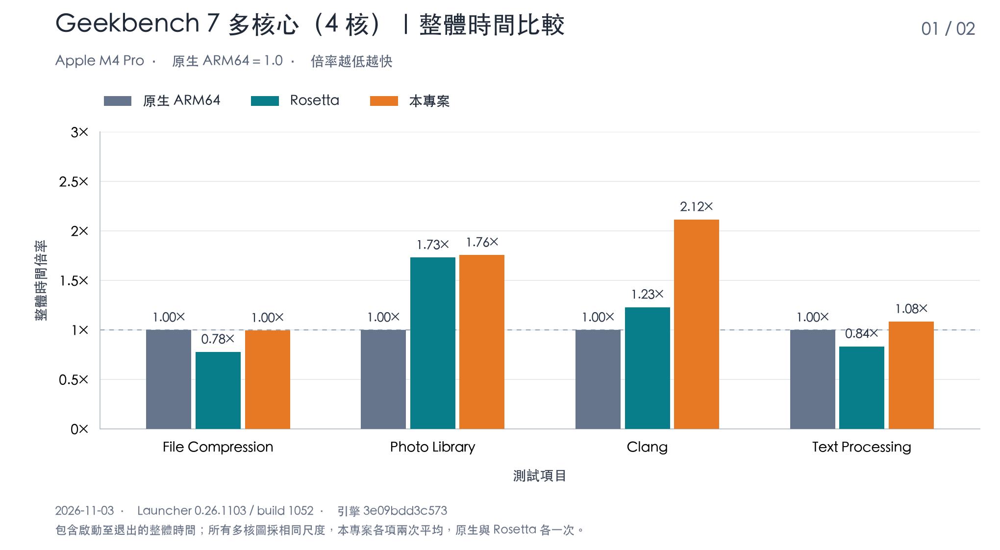
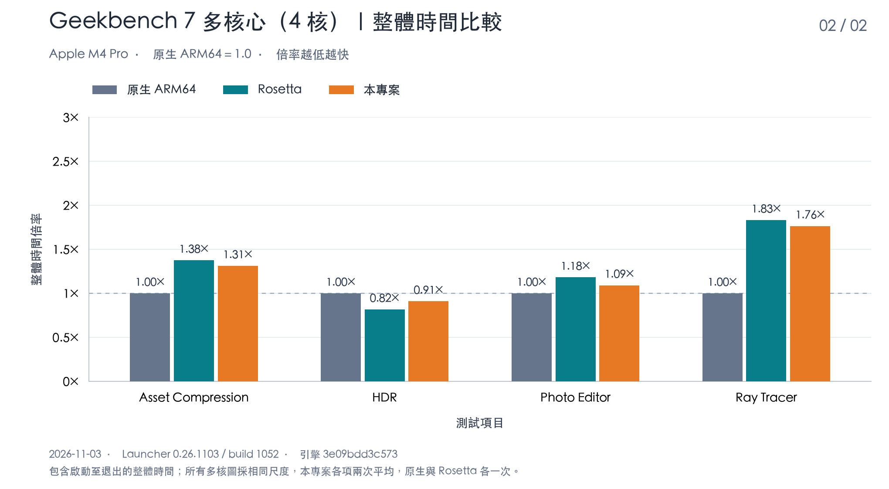

# AppleJuice

[繁體中文](README.md) · [English](README.en.md) · [日本語](README.ja.md) · [한국어](README.ko.md)

AppleJuice は、Apple Silicon Mac 上で対応する Windows アプリケーションを実行する互換性プロジェクトです。GUI の **Win64 Launcher** とコマンドラインツール **x64arm** を提供します。PE／DLL の読み込みと Windows 互換サービスを担い、ウィンドウ、描画、音声、入力を macOS のネイティブインターフェイスと Metal に接続します。

完全な `x64kernel/` 静的 SDK を同梱しており、通常のビルドにカーネルのソースは不要です。カーネルは別の AppleJuiceKernel で提供します。静的リンクした実行ファイルと Launcher パッケージも AppleJuice の配布対象であり、適用されるライセンスを保持する必要があります。

## 目標と特徴

- **Windows システムファイルを不要にする**：Windows のインストールや Windows システム DLL の提供なしに、対応するアプリケーションを実行することを目指します。アプリケーションと付属の依存ファイルは利用者が用意します。
- **ネイティブ ARM64 命令を優先する**：x86／x64 命令の意味とアプリケーションの動作を保ちながら、Apple Silicon の ARM64 命令と NEON ベクトル演算を可能な限り使用します。
- **ネイティブのハードウェアアクセラレーションを使う**：描画と GPU 計算には Metal を優先し、動画処理などには macOS のフレームワークと利用可能なハードウェア支援を活用します。

## Geekbench 7 シングルコアの総経過時間

2026 年 11 月 2 日、Apple M4 Pro、メモリ 64 GiB、macOS 27.0.1 の環境で、AppleJuice Launcher 0.26.1102（build 122）を使って Geekbench 7.0.0 Pro（build 703423）の 16 個のシングルコア測定項目を測定しました。ネイティブ ARM64 と Rosetta の値は 2026 年 10 月 23 日の測定値です。すべて順番に実行し、各プロセスは 1 コアを使用し、ウォームアップ 1 回と本測定 3 回を行いました。公式の作業量は 3 者で項目ごとに同一です。

**各項目のネイティブ ARM64 の総経過時間を 1.0 としています。倍率が低いほど高速です。** 総経過時間はプロセスの起動から終了までで、初期化、キャリブレーション、ウォームアップ、本測定、プロセス内の結果書き込みを含みます。計測ツールによる入力準備、アイドル待機、終了後の後処理は含みません。4 枚のグラフは同じ Y 軸スケールを使い、それぞれ 4 項目を示します。

AppleJuice は Windows x86_64 版、Rosetta は macOS x86_64 版、ネイティブ実行は macOS ARM64 版を使用します。AppleJuice は有効な全プロセスの算術平均で、各項目 2 回、計 32 回です。ネイティブ ARM64 は各項目 1 回、Rosetta は HDR が 3 回の平均、その他の項目は各 1 回です。3 者の測定時期とサンプル数は異なり、外部負荷も含むため、グラフは実測結果を示すもので統計的な有意性は主張しません。総経過時間は測定値をそのまま使用し、演算効率の改善率は適用していません。

ネイティブ ARM64 版はテスト開始前のシステム情報の収集に約 4.6 秒、Rosetta は約 1.6 秒かかります。そのため一部の項目では Rosetta の総経過時間がネイティブより短くなりますが、本測定の演算時間はすべての項目でネイティブが最速です。

**Clang の進捗：** AppleJuice の総経過時間は **17.96 秒から 12.83 秒に短縮（28.56% 減）**し、ネイティブ比の倍率は **1.55× から 1.11×** に下がりました。この値は現時点で採用済みのビルドによる有効な本測定プロセス 4 回の平均です。更新したのは Clang の AppleJuice の棒のみで、ネイティブ／Rosetta の基準値とほかの測定項目は元のデータのままです。









## Geekbench 7 マルチコアの総経過時間

2026 年 11 月 3 日、同じ Apple M4 Pro（macOS 27.0.1）で、Launcher 0.26.1103（build 1052、GitHub Release 版）を使い、Geekbench 7.0.0 Pro（build 703423）が公式にマルチコアモードを提供する 8 項目を 2 コアと 4 コアでそれぞれ測定しました。3 者は同じワーカー数、ウォームアップ 1 回と本測定 3 回を使い、公式の作業量は項目ごとに同一です。同じコア数のネイティブ ARM64、Rosetta、AppleJuice は同じ時間帯に交互に測定しました。

算出方法はシングルコアのグラフと同じです。**各項目のネイティブ ARM64 の総経過時間を 1.0 としています。倍率が低いほど高速です。** 総経過時間はプロセスの起動から終了までです。2 コアと 4 コアの計 4 枚のグラフは同じ Y 軸スケールを使い、それぞれ 4 項目を示します。

AppleJuice は各項目 2 回の算術平均、ネイティブ ARM64 と Rosetta は各 1 回です。本測定の前に 3 者とも 1 回ウォームアップし、結果には含めていません。測定中はホストで他のプログラムも動作していました。実行中に他の作業の影響で負荷が大きく上昇した結果は除外し、測定し直しています。グラフは実測結果を示すもので、統計的な有意性は主張しません。

シングルコアと同様に、ネイティブ ARM64 版はシステム情報の収集に時間がかかるため、File Compression、Text Processing、HDR では Rosetta の総経過時間がネイティブより短くなっています。本測定の演算時間はすべての項目でネイティブが最速です。

**Clang の進捗：** シングルコアの進捗グラフと同じ採用済みビルドで再測定し、2 コアの総経過時間は **90.54 秒から 79.34 秒に短縮（12.37% 減）**、4 コアは **55.33 秒から 50.15 秒に短縮（9.37% 減）**しました。ネイティブ比の倍率はそれぞれ **2.19× から 1.92×**、**2.12× から 1.92×** に下がりました。コア数ごとに最初にウォームアップ用のプロセスを 1 回実行し、続く有効な本測定プロセス 2 回の平均を取りました。各プロセスはウォームアップ 1 回と本測定 3 回で、ゲストメモリは 8 GiB です。更新したのは Clang の AppleJuice の棒のみで、ほかの測定項目とネイティブ／Rosetta の基準値は元のデータのままです。新旧の測定は時間帯が異なり、新しい測定にはバックグラウンドのゲスト負荷が含まれます。ビルドや別のプローブによる干渉は検出されていませんが、統計的に有意とは主張しません。









## はじめに

Apple Silicon Mac、Xcode Command Line Tools、CMake 3.24 以降、Ninja、Python 3、Perl、make、Go 1.23 以降、MinGW x64 GCC（`x86_64-w64-mingw32-gcc`）を用意してください。フロントエンドのリソースは同梱されており、通常のビルドに Node.js は不要です。初回の Go ビルドにはネットワーク接続またはモジュールキャッシュが必要です。

リポジトリのルートで実行するか、Finder で `run.command` をダブルクリックします。

```sh
./run.command
```

ビルド後に `build/launcher/Win64 Launcher.app` が開きます。「EXE を追加」から用意した Windows アプリケーションを選び、作業フォルダ、コマンドライン、ドライブマッピング、書き込み権限を設定して再生ボタンを押します。コンソールアプリケーションは内蔵ターミナルを、GUI アプリケーションは独立したウィンドウを使用します。

## ソースからビルド

```sh
cmake --preset release
cmake --build --preset release --target x64arm --parallel 4
./build/release/x64arm doctor
python3 scripts/build_launcher.py --jobs 4
```

最初の 3 行で CLI をビルドして確認し、最後の行で Launcher をビルドしてパッケージ化します。SDK のヘッダー、静的ライブラリ、CMake 設定、ライセンスを一式で保持し、異なるバージョンを混在させないでください。固定された第三者ソースとライセンスも同梱しています。

## ドキュメントと互換性

[はじめに](docs/getting-started.md) · [Launcher の操作](docs/launcher.md) · [ビルドとパッケージ化](docs/build-and-release.md) · [実行と互換性](docs/realworld-support.md) · [GPU メモリ](docs/gpu-memory.md) · [Geekbench の実行方法](docs/geekbench7-single-core.md) · [ドキュメント一覧](docs/README.md)

詳細な使用ドキュメントは現在、繁体中国語で提供しています。x64 OpenCL は macOS OpenCL.framework、Vulkan は Vulkan loader／MoltenVK を使用します。要件と制限は [OpenCL／Vulkan](docs/opencl-vulkan-support.md) を参照してください。

### CPU とマルチコア

32／64 ビットのアプリケーションは既定で resident AOT を使用します。Launcher ではアプリケーションごとにゲストの CPU コア数を設定でき、複数のゲストスレッドを常駐 worker で並行実行します。2026 年 11 月 2 日に Geekbench 7 の公式マルチコア 8 項目で測定した結果、単一コアの基準に対して 2 コアで 1.79～2.18 倍、4 コアで 2.84～4.35 倍でした。

### Direct3D 9

D3D9／D3D9Ex のデバイス、テクスチャとバッファ、固定機能とプログラマブル描画、スワップチェーン、Metal による表示を提供します。特殊な形式、デバイス機能、描画状態の組み合わせには互換性の制限があります。

### Direct3D 10／10.1

D3D10／D3D10.1 のデバイス、リソース、シェーダー、描画、DXGI スワップチェーンを Metal に接続します。デバイスの作成成功やバージョン番号だけで、すべての機能や形式への対応を判断することはできません。

### Direct3D 11

デバイスとコンテキスト、リソースとビュー、DXBC シェーダー変換、Draw／Dispatch、DXGI 表示を提供し、描画と GPU 計算の経路を含みます。D3D11.1～11.4 のインターフェイスは同じ処理経路に接続し、シェーダーはバックグラウンドで変換できます。高度な機能、形式、拡張インターフェイスはアプリケーションの要件に応じて確認が必要です。feature level の表示は 11.x 全体の互換性を示しません。複数 vCPU では、戻り値のないメソッドをコマンドストリーム経由で専用スレッドが順に実行し、描画スレッドの待ちを減らします（`X64ARM_D3D11_STREAM=0` で無効）。

### Direct3D 12

デバイス、コマンドキュー／リスト、リソースと記述子、ルートシグネチャ、描画／計算、fence、DXGI 表示の一部を Metal で実行し、コマンドリストは専用の送信スレッドで再生します。間接コマンドと Bundle の実行経路がありますが、DXR、Mesh Shader、Work Graph などの高度な機能について完全な互換性は保証しません。

### x86（32 ビット Windows）

x86_64（64 ビット）に加えて、x86 PE32 の EXE と対応する DLL を読み込めます。32／64 ビットとも既定で resident AOT を使用します。付属 DLL のビット数は EXE と一致させる必要があり、同一プロセスで 32／64 ビット DLL を混在させることはできません。API や描画機能の対応範囲は x64 と異なる場合があり、完全な WOW64、16 ビットアプリケーション、カーネルドライバー、DRM への対応を示すものではありません。

詳細と使用上の案内は [Direct3D と x86 の互換性](docs/direct3d-and-x86.md)（繁体中国語）を参照してください。

### その他の API

- **OpenGL／WebGL**：OpenGL／WGL は既定で Metal で描画し、初期化に失敗した場合は macOS の OpenGL を使用します。WebGL が使う EGL／GLES は ANGLE の Metal バックエンドで処理します。
- **オーディオ**：DirectSound（3D 定位と録音を含む）、XAudio2、WASAPI、X3DAudio を Core Audio で出力し、ステレオの左右チャンネルとパンを保持します。
- **入力**：DirectInput（フォースフィードバックを含む）、XInput、Raw Input は macOS の物理入力デバイスのデータを使用します。
- **動画**：Media Foundation と D3D11 DXVA の H.264 エンコード／デコードは VideoToolbox のハードウェアアクセラレーションを使用します。HEVC と AV1 は未完成です。

AppleJuice は開発中です。Windows 全体、すべてのアプリケーション、すべての API 引数の組み合わせには対応していません。読み込みやウィンドウの表示が成功しても、アプリケーション全体の互換性を保証するものではありません。ドライブマッピングは完全な OS サンドボックスではなく、有効なサービスはマッピング先のファイルやネットワークにアクセスする場合があります。信頼できるプログラムだけを実行し、必要に応じてアクセス権を設定してください。

リポジトリには `src/`、`include/`、`launcher/`、`cmake/`、必要なビルドスクリプト、`third_party/`、`x64kernel/` と使用ドキュメントを含みます。

## 動作確認の記録 / 2026-11-09 / 全 19 本のゲーム

 動作しないが対応中　 メイン画面まで起動　 動作するが効率は低い　 良好に動作

| アプリケーション | x64/x86 | 主な動作コア | 対応状況 |
| --- | --- | --- | :---: |
| 7-Zip | x64 | Win32 GUI |  |
| Geekbench 7 | x64 | CPU |  |
| Memelis' RPG | x86 | RPG Maker MV |  |
| ドラゴンクエストIII　そして伝説へ… | x64 | D3D11（Unreal Engine 4） |  |
| 艾莉露在异世界的冒险之不死之冠 | x86 | RPG Maker MV |  |
| 不谙世事的猫艾露莎 | x86 | RPG Maker MV |  |
| 永恒的黄昏 | x86 | RPG Maker MV |  |
| ファイナルファンタジーVIII | x86 | D3D9 |  |
| ファイナルファンタジーIX | x64 | D3D9（Unity） |  |
| 逆転裁判123 成歩堂セレクション | x86 | D3D11（Unity） |  |
| 天穂のサクナヒメ | x64 | D3D11 |  |
| トゥームレイダー（2013） | x86 | D3D11 |  |
| It Takes Two | x64 | D3D11（Unreal Engine 4） |  |
| Steam | x64 | Chromium（CEF） |  |
| サイバーパンク2077 | x64 | D3D12 |  |
| 三國志X with パワーアップキット | x86 | 不明 |  |
| 小涵的暑假 | x64 | RPG Maker MV |  |
| 勇者的粉色育女日记 | x64 | RPG Maker MZ |  |
| Clair Obscur: Expedition 33 | x64 | D3D11 (Unreal Engine 5) |  |
| デイヴ・ザ・ダイバー | x64 | D3D11（Unity） |  |
| 特警シグナルフォース | x86 | RPG Maker MV |  |
| ライズ オブ ザ トゥームレイダー | x64 | D3D11 |  |

記録は当時のバージョンと設定によるもので、ゲーム全体の流れ、他のバージョン、すべての設定での動作を示すものではありません。

## 開発を支援

AppleJuice が役に立ったら、コーヒー一杯で継続的な開発を応援していただけると嬉しいです。

[☕ Buy Me a Coffee](https://buymeacoffee.com/vaderchen)

## ライセンス

Copyright (C) 2026 VaderChen.

x64arm エンジンと Win64 Launcher を含む AppleJuice の自作部分には、[ソース公開・商業販売禁止ライセンス](LICENSE.ja.md)を適用します。企業内利用を含む非販売の利用、変更、無料共有を許可します。ソフトウェア販売、有料ホスティング／SaaS、有料サービス、有料製品への統合は禁止します。従業員の通常の給与は販売とみなしませんが、ソフトウェア提供による広告収入、紹介報酬、利用者データの収益化も制限します。必要な場合は著作権者と別途書面による許諾をご相談ください。問い合わせだけでは許諾になりません。

AppleJuiceKernel を静的リンクした実行ファイルと Launcher パッケージも AppleJuice の配布対象です。製品にはカーネルと第三者のライセンス表示を保持してください。リポジトリの分離によって既存のライセンス制限は変わりません。

独自のソース公開ライセンスであり、OSI のオープンソース定義に適合すると主張しません。README は要約です。繁体中国語の全文を正本とし、第三者コンポーネント、別途ライセンスの内容、外部 Windows プログラムには各自のライセンスを適用します。

ライセンス全文：[繁體中文](LICENSE.md) · [English](LICENSE.en.md) · [日本語](LICENSE.ja.md) · [한국어](LICENSE.ko.md)

[商業販売ポリシー](COMMERCIAL-LICENSE.md) · [適用範囲と出典](docs/licensing.md) · [第三者ライセンス](THIRD-PARTY-NOTICES.md)
