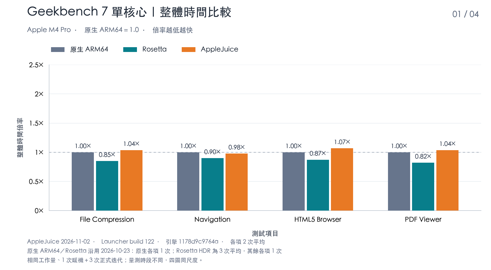
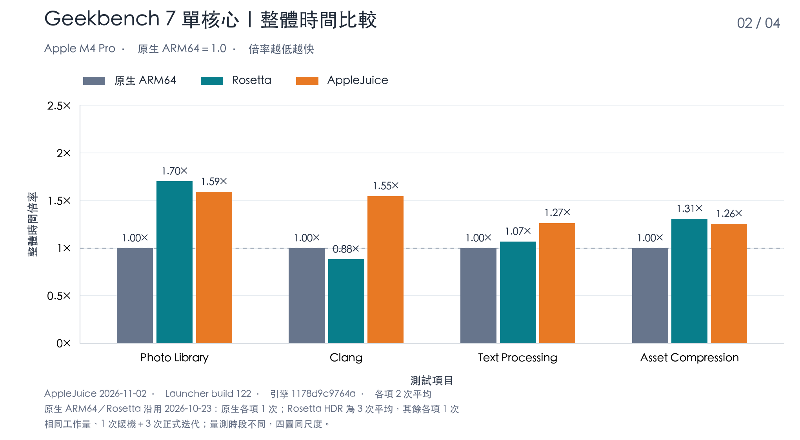
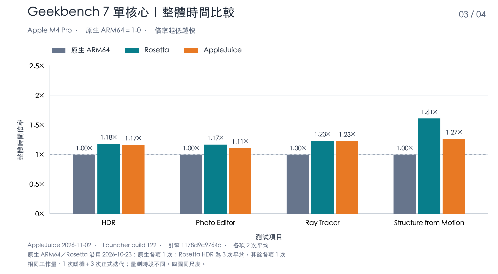
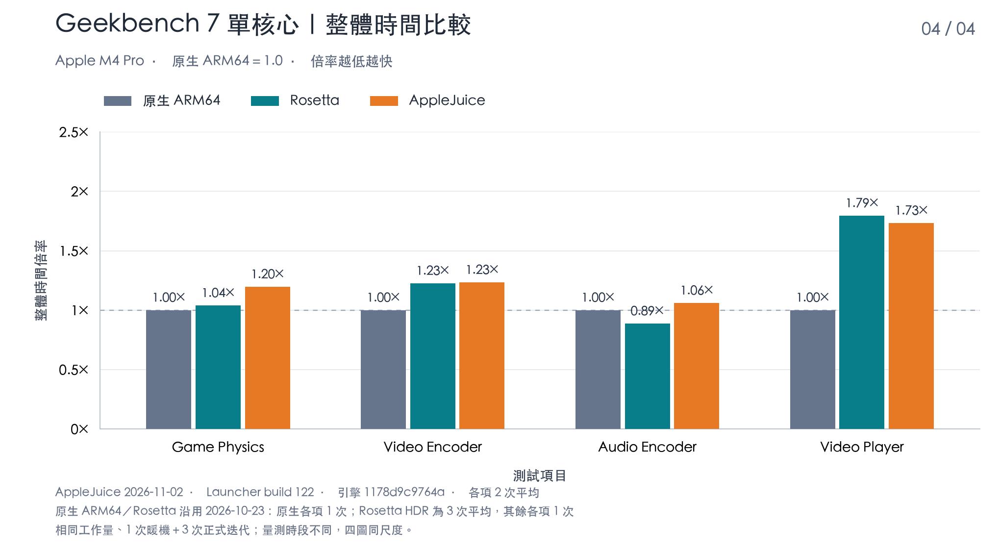
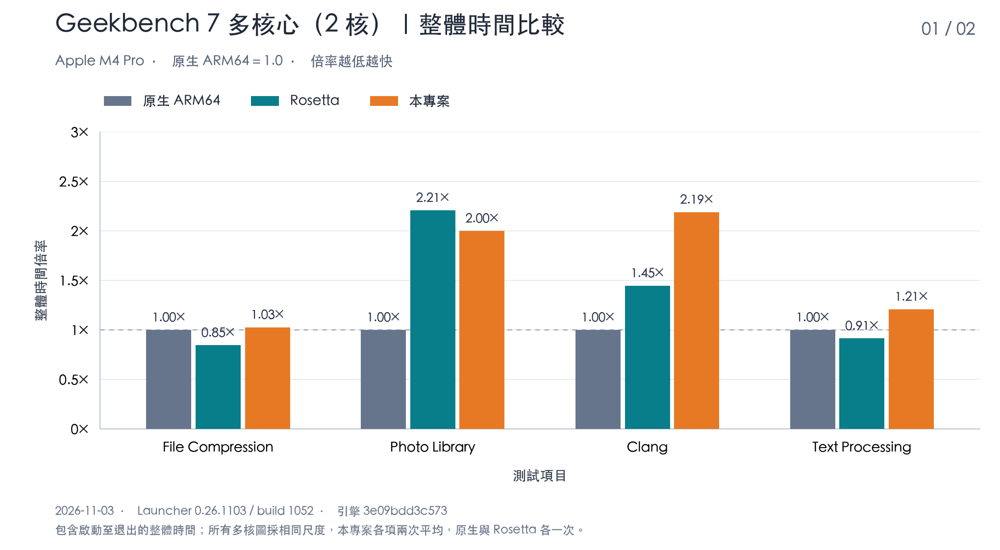
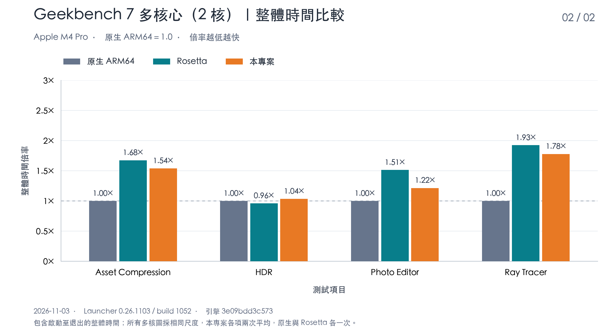
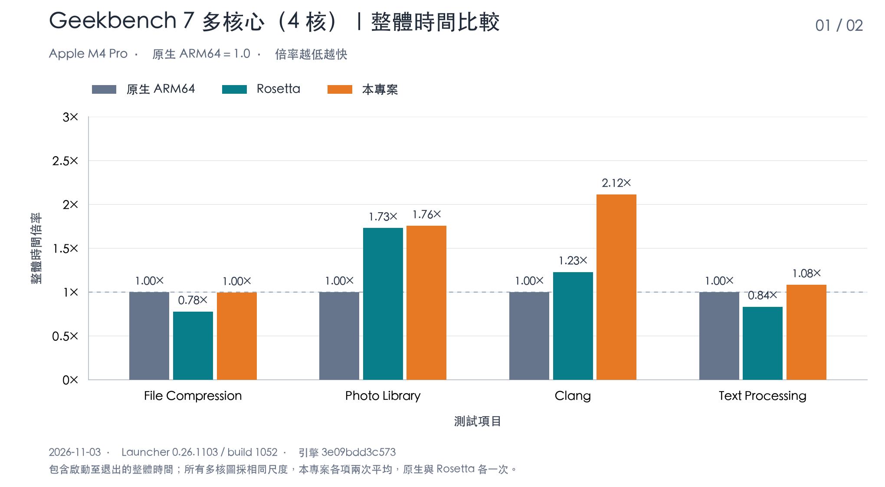
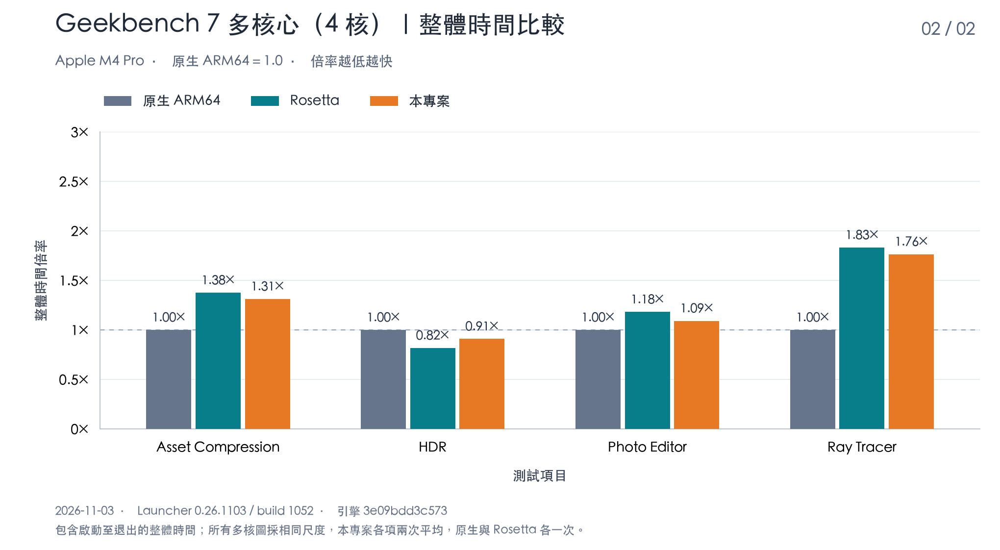

# AppleJuice

[繁體中文](README.md) · [English](README.en.md) · [日本語](README.ja.md) · [한국어](README.ko.md)

AppleJuice는 Apple Silicon Mac에서 지원되는 Windows 프로그램을 실행하는 호환성 프로젝트입니다. 그래픽 실행기 **Win64 Launcher**와 명령줄 도구 **x64arm**을 제공합니다. PE/DLL 로딩과 Windows 호환 서비스를 제공하며 창, 그래픽, 오디오 및 입력을 macOS 네이티브 인터페이스와 Metal에 연결합니다.

완전한 `x64kernel/` 정적 SDK가 포함되어 있어 일반 빌드에는 커널 소스가 필요하지 않습니다. 커널은 별도의 AppleJuiceKernel에서 제공합니다. 정적으로 링크한 실행 파일과 Launcher 패키지도 AppleJuice의 배포 대상이며, 배포 시 해당 라이선스를 유지해야 합니다.

## 목표와 특징

- **Windows 시스템 파일 없이 실행**: Windows를 설치하거나 Windows 시스템 DLL을 제공하지 않고 지원되는 프로그램을 실행하는 것을 목표로 합니다. 프로그램과 함께 제공되는 종속 파일은 사용자가 준비합니다.
- **네이티브 ARM64 명령 우선 사용**: x86/x64 명령의 의미와 프로그램 동작을 유지하면서 Apple Silicon의 ARM64 명령과 NEON 벡터 연산을 가능한 한 사용합니다.
- **네이티브 하드웨어 가속 활용**: 그래픽과 GPU 연산에는 Metal을 우선 사용하고, 영상 처리 같은 작업에는 macOS 프레임워크와 사용 가능한 하드웨어 가속을 활용합니다.

## Geekbench 7 싱글 코어 전체 경과 시간

2026년 11월 2일 Apple M4 Pro, 메모리 64 GiB, macOS 27.0.1 환경에서 AppleJuice Launcher 0.26.1102(build 122)로 Geekbench 7.0.0 Pro(build 703423)의 싱글 코어 항목 16개를 측정했습니다. 네이티브 ARM64와 Rosetta 값은 2026년 10월 23일 측정값입니다. 모두 순차적으로 실행했으며, 각 프로세스는 코어 하나를 사용하고 워밍업 1회와 본 측정 3회를 수행했습니다. 공식 작업량은 세 환경에서 항목별로 동일합니다.

**각 항목의 네이티브 ARM64 전체 경과 시간을 1.0으로 정규화했으며, 배수가 낮을수록 빠릅니다.** 전체 경과 시간은 프로세스 시작부터 종료까지이며 초기화, 보정, 워밍업, 본 측정 및 프로세스 내부의 결과 기록을 포함합니다. 측정 도구의 입력 준비, 유휴 대기 및 종료 후 정리는 제외합니다. 네 그래프는 동일한 Y축 범위를 사용하며 각각 네 항목을 표시합니다.

AppleJuice는 Windows x86_64 버전, Rosetta는 macOS x86_64 버전, 네이티브 실행은 macOS ARM64 버전을 사용합니다. AppleJuice 값은 유효한 모든 프로세스의 산술 평균으로, 항목당 2회, 총 32회입니다. 네이티브 ARM64는 항목당 1회이며, Rosetta는 HDR이 3회 평균이고 나머지 항목은 각 1회입니다. 세 환경의 측정 시기와 표본 수가 다르고 외부 부하가 포함되어 있으므로, 그래프는 실측 결과를 보여 줄 뿐 통계적 유의성을 주장하지 않습니다. 전체 경과 시간은 측정값을 그대로 사용했으며 연산 효율 개선율은 적용하지 않았습니다.

네이티브 ARM64 버전은 테스트 시작 전 시스템 정보를 수집하는 데 약 4.6초, Rosetta는 약 1.6초가 걸립니다. 따라서 일부 항목에서는 Rosetta의 전체 경과 시간이 네이티브보다 짧지만, 본 측정의 연산 시간은 모든 항목에서 네이티브가 가장 빠릅니다.

**Clang 진행 상황:** AppleJuice의 전체 경과 시간은 **17.96초에서 12.83초로 28.56% 단축**되었고, 네이티브 대비 배수는 **1.55×에서 1.11×**로 낮아졌습니다. 이 값은 현재까지 채택된 빌드로 수행한 유효 본 측정 프로세스 4회의 평균입니다. Clang의 AppleJuice 막대만 갱신했으며 네이티브/Rosetta 기준값과 다른 항목은 기존 데이터를 그대로 사용합니다.









## Geekbench 7 멀티코어 전체 경과 시간

2026년 11월 3일 동일한 Apple M4 Pro(macOS 27.0.1)에서 Launcher 0.26.1103(build 1052, GitHub Release 버전)으로 Geekbench 7.0.0 Pro(build 703423)가 공식적으로 멀티코어 모드를 제공하는 8개 항목을 2코어와 4코어로 각각 측정했습니다. 세 환경은 동일한 워커 수, 워밍업 1회와 본 측정 3회를 사용했으며 공식 작업량은 항목별로 동일합니다. 같은 코어 수의 네이티브 ARM64, Rosetta, AppleJuice는 같은 시간대에 번갈아 측정했습니다.

계산 방식은 싱글 코어 그래프와 같습니다. **각 항목의 네이티브 ARM64 전체 경과 시간을 1.0으로 정규화했으며, 배수가 낮을수록 빠릅니다.** 전체 경과 시간은 프로세스 시작부터 종료까지입니다. 2코어와 4코어의 네 그래프는 동일한 Y축 범위를 사용하며 각각 네 항목을 표시합니다.

AppleJuice 값은 항목당 2회의 산술 평균이며, 네이티브 ARM64와 Rosetta는 각 1회입니다. 본 측정 전에 세 환경 모두 워밍업을 1회 실행했으며 결과에는 포함하지 않았습니다. 측정 중 호스트에서는 다른 프로그램도 실행 중이었으며, 실행 중 다른 작업으로 부하가 크게 오른 결과는 제외하고 다시 측정했습니다. 그래프는 실측 결과를 보여 줄 뿐 통계적 유의성을 주장하지 않습니다.

싱글 코어와 마찬가지로 네이티브 ARM64 버전은 시스템 정보 수집에 시간이 더 걸리므로 File Compression, Text Processing, HDR에서는 Rosetta의 전체 경과 시간이 네이티브보다 짧습니다. 본 측정의 연산 시간은 모든 항목에서 네이티브가 가장 빠릅니다.

**Clang 진행 상황:** 싱글 코어 진행 차트와 같은 채택 빌드로 다시 측정한 결과 2코어 전체 경과 시간은 **90.54초에서 79.34초로 12.37% 단축**되었고, 4코어는 **55.33초에서 50.15초로 9.37% 단축**되었습니다. 네이티브 대비 배수는 각각 **2.19×에서 1.92×**, **2.12×에서 1.92×**로 낮아졌습니다. 코어 수마다 먼저 워밍업 프로세스를 1회 실행한 뒤 유효 본 측정 프로세스 2회의 평균을 사용했습니다. 각 프로세스는 워밍업 1회와 본 측정 3회를 수행했으며 게스트 메모리는 8 GiB입니다. Clang의 AppleJuice 막대만 갱신했으며 다른 항목과 네이티브/Rosetta 기준값은 기존 데이터를 그대로 사용합니다. 기존 측정과 새 측정은 시간대가 다르며 새 측정에는 백그라운드 게스트 부하가 있었습니다. 빌드나 별도 프로브의 간섭은 감지되지 않았지만 통계적 유의성을 주장하지는 않습니다.









## 시작하기

Apple Silicon Mac, Xcode Command Line Tools, CMake 3.24 이상, Ninja, Python 3, Perl, make, Go 1.23 이상 및 MinGW x64 GCC(`x86_64-w64-mingw32-gcc`)가 필요합니다. 프런트엔드 리소스가 포함되어 있어 일반 빌드에는 Node.js가 필요하지 않습니다. 첫 Go 빌드에는 네트워크 연결 또는 모듈 캐시가 필요합니다.

저장소 루트에서 실행하거나 Finder에서 `run.command`를 두 번 클릭합니다.

```sh
./run.command
```

빌드가 끝나면 `build/launcher/Win64 Launcher.app`이 열립니다. “EXE 추가”를 눌러 준비한 Windows 프로그램을 선택하고 작업 폴더, 명령줄, 드라이브 매핑 및 쓰기 권한을 설정한 뒤 재생 버튼을 누릅니다. 콘솔 프로그램은 내장 터미널을 사용하고 GUI 프로그램은 별도 창으로 열립니다.

## 소스에서 빌드

```sh
cmake --preset release
cmake --build --preset release --target x64arm --parallel 4
./build/release/x64arm doctor
python3 scripts/build_launcher.py --jobs 4
```

처음 세 줄은 CLI를 빌드하고 확인하며, 마지막 줄은 Launcher를 빌드하고 패키징합니다. SDK의 헤더, 정적 라이브러리, CMake 설정 및 라이선스를 함께 유지하고 서로 다른 버전을 혼용하지 마세요. 고정된 타사 소스와 라이선스도 포함되어 있습니다.

## 문서와 호환성

[시작하기](docs/getting-started.md) · [Launcher 사용법](docs/launcher.md) · [빌드와 패키징](docs/build-and-release.md) · [실행과 호환성](docs/realworld-support.md) · [GPU 메모리](docs/gpu-memory.md) · [Geekbench 실행 방법](docs/geekbench7-single-core.md) · [문서 목록](docs/README.md)

상세 사용 문서는 현재 번체 중국어로 제공됩니다. x64 OpenCL과 Vulkan은 각각 macOS OpenCL.framework 및 Vulkan loader/MoltenVK를 사용합니다. 요구 사항과 제한은 [OpenCL/Vulkan](docs/opencl-vulkan-support.md)을 참고하세요.

### CPU와 멀티코어

32비트와 64비트 프로그램 모두 기본적으로 resident AOT를 사용합니다. Launcher에서 프로그램별로 게스트 CPU 코어 수를 설정할 수 있으며, 여러 게스트 스레드는 상주 worker에서 병렬로 실행됩니다. 2026년 11월 2일 Geekbench 7의 공식 멀티코어 8개 항목으로 측정한 결과, 싱글 코어 기준 대비 2코어에서 1.79~2.18배, 4코어에서 2.84~4.35배였습니다.

### Direct3D 9

D3D9/D3D9Ex 장치, 텍스처와 버퍼, 고정 기능 및 프로그래밍 가능한 렌더링, 스왑 체인과 Metal 화면 출력을 제공합니다. 특수 형식, 장치 기능 및 렌더링 상태 조합에는 호환성 제한이 있습니다.

### Direct3D 10/10.1

D3D10/D3D10.1 장치, 리소스, 셰이더, 렌더링 및 DXGI 스왑 체인을 Metal에 연결합니다. 장치 생성 성공이나 버전 번호가 모든 기능 및 형식 지원을 의미하지는 않습니다.

### Direct3D 11

장치와 컨텍스트, 리소스와 뷰, DXBC 셰이더 변환, Draw/Dispatch 및 DXGI 화면 출력을 제공하며 그래픽과 GPU 연산 경로를 포함합니다. D3D11.1~11.4 인터페이스는 같은 처리 경로로 연결되며 셰이더는 백그라운드에서 변환할 수 있습니다. 고급 기능, 형식 및 확장 인터페이스는 프로그램의 요구 사항에 따라 확인해야 합니다. 보고된 feature level이 완전한 11.x 호환성을 의미하지는 않습니다. vCPU가 여러 개일 때 반환값이 없는 메서드는 명령 스트림을 거쳐 전용 스레드에서 순서대로 실행되어 렌더링 스레드의 대기가 줄어듭니다(`X64ARM_D3D11_STREAM=0`으로 끔).

### Direct3D 12

장치, 명령 큐/목록, 리소스와 디스크립터, 루트 서명, 그래픽/연산, fence 및 DXGI 화면 출력의 일부 기능을 Metal로 실행하며, 명령 목록은 전용 제출 스레드에서 재생합니다. 간접 명령과 Bundle 실행 경로가 있지만 DXR, Mesh Shader, Work Graph 같은 고급 기능은 완전한 호환성 보장 범위에 포함되지 않습니다.

### x86(32비트 Windows)

x86_64(64비트) 외에도 x86 PE32 EXE와 해당 DLL을 로드할 수 있습니다. 32비트와 64비트 프로그램 모두 기본적으로 resident AOT를 사용합니다. 함께 제공되는 DLL의 비트 수는 EXE와 같아야 하며, 한 프로세스에서 32비트와 64비트 DLL을 혼용할 수 없습니다. x86의 API 및 그래픽 지원 범위는 x64와 다를 수 있으며, 완전한 WOW64, 16비트 프로그램, 커널 드라이버 또는 DRM 지원을 의미하지는 않습니다.

자세한 범위와 사용 안내는 [Direct3D 및 x86 호환성](docs/direct3d-and-x86.md)(번체 중국어)을 참고하세요.

### 기타 API

- **OpenGL/WebGL**: OpenGL/WGL은 기본적으로 Metal로 렌더링하며 초기화에 실패하면 macOS OpenGL을 사용합니다. WebGL이 사용하는 EGL/GLES는 ANGLE의 Metal 백엔드에서 처리합니다.
- **오디오**: DirectSound(3D 위치 지정 및 녹음 포함), XAudio2, WASAPI, X3DAudio를 Core Audio로 출력하며 스테레오 좌우 채널과 패닝을 유지합니다.
- **입력**: DirectInput(포스 피드백 포함), XInput, Raw Input은 macOS 실제 입력 장치의 데이터를 사용합니다.
- **동영상**: Media Foundation과 D3D11 DXVA의 H.264 인코딩/디코딩은 VideoToolbox 하드웨어 가속을 사용합니다. HEVC와 AV1은 아직 완료되지 않았습니다.

AppleJuice는 개발 중이며 전체 Windows, 모든 프로그램 및 모든 API 매개변수 조합을 완전히 지원하지 않습니다. 프로그램 로딩이나 창 표시가 성공해도 전체 프로그램의 호환성이 보장되지는 않습니다. 드라이브 매핑은 완전한 OS 샌드박스가 아니며 활성화된 서비스는 매핑된 파일이나 네트워크에 접근할 수 있습니다. 신뢰할 수 있는 프로그램만 실행하고 필요한 접근 권한을 설정하세요.

저장소에는 `src/`, `include/`, `launcher/`, `cmake/`, 필수 빌드 스크립트, `third_party/`, `x64kernel/` 및 사용 문서가 포함되어 있습니다.

## 실측 기록 / 2026-11-07 / 게임 총 18개

 동작하지 않지만 작업 중 ·  메인 화면까지 실행 ·  동작하지만 효율이 낮음 ·  원활히 동작

| 프로그램 | x64/x86 | 주요 동작 코어 | 지원 수준 |
| --- | --- | --- | :---: |
| 7-Zip | x64 | Win32 GUI |  |
| Geekbench 7 | x64 | CPU |  |
| Memelis' RPG | x86 | RPG Maker MV |  |
| 드래곤 퀘스트 III HD-2D Remake | x64 | D3D11(Unreal Engine 4) |  |
| 艾莉露在异世界的冒险之不死之冠 | x86 | RPG Maker MV |  |
| 不谙世事的猫艾露莎 | x86 | RPG Maker MV |  |
| 永恒的黄昏 | x86 | RPG Maker MV |  |
| 파이널 판타지 VIII | x86 | D3D9 |  |
| 파이널 판타지 IX | x64 | D3D9(Unity) |  |
| 역전재판 123 나루호도 셀렉션 | x86 | D3D11(Unity) |  |
| 천수의 사쿠나히메 | x64 | D3D11 |  |
| It Takes Two | x64 | D3D11(Unreal Engine 4) |  |
| Romance of the Three Kingdoms X with Power Up Kit | x86 | 알 수 없음 |  |
| Steam | x64 | Chromium(CEF) |  |
| 사이버펑크 2077 | x64 | D3D12 |  |
| 小涵的暑假 | x64 | RPG Maker MV |  |
| 勇者的粉色育女日记 | x64 | RPG Maker MZ |  |
| 클레르 옵스퀴르: 33 원정대 | x64 | D3D11 (Unreal Engine 5) |  |
| Signal Force | x86 | RPG Maker MV |  |
| 데이브 더 다이버 | x64 | D3D11(Unity) |  |
| 라이즈 오브 더 툼 레이더 | x64 | D3D11 |  |

실측 기록은 당시 버전과 설정 기준이며, 전체 게임 진행, 다른 버전 또는 모든 설정에서의 동작을 의미하지 않습니다.

## 개발 후원

AppleJuice가 도움이 되었다면 커피 한 잔으로 지속적인 개발을 응원해 주세요.

[☕ Buy Me a Coffee](https://buymeacoffee.com/vaderchen)

## 라이선스

Copyright (C) 2026 VaderChen.

x64arm 엔진과 Win64 Launcher를 포함한 AppleJuice 자체 콘텐츠에는 [소스 공개·상업적 판매 금지 라이선스](LICENSE.ko.md)를 적용합니다. 기업 내부 사용을 포함한 비판매 사용, 수정 및 무료 공유를 허용합니다. 소프트웨어 판매, 유료 호스팅/SaaS, 유료 서비스 및 유료 제품 통합은 금지합니다. 직원의 통상적인 급여는 판매로 보지 않지만 소프트웨어 제공을 통한 광고 수익, 추천 수수료 및 사용자 데이터 수익화도 제한됩니다. 필요한 경우 저작권자와 별도의 서면 라이선스를 논의하세요. 문의 자체로 허가가 부여되지는 않습니다.

AppleJuiceKernel을 정적으로 링크한 실행 파일과 Launcher 패키지도 AppleJuice의 배포 대상입니다. 배포물에 커널과 타사 라이선스 고지를 유지해야 하며, 저장소 분리는 기존 라이선스 제한을 변경하지 않습니다.

자체 소스 공개 라이선스이며 OSI 오픈 소스 정의에 부합한다고 주장하지 않습니다. README는 요약이며 번체 중국어 전문이 기준입니다. 타사 구성 요소, 별도로 라이선스된 콘텐츠 및 외부 Windows 프로그램에는 각자의 라이선스가 적용됩니다.

전체 라이선스: [繁體中文](LICENSE.md) · [English](LICENSE.en.md) · [日本語](LICENSE.ja.md) · [한국어](LICENSE.ko.md)

[상업적 판매 정책](COMMERCIAL-LICENSE.md) · [적용 범위 및 출처](docs/licensing.md) · [타사 라이선스](THIRD-PARTY-NOTICES.md)
