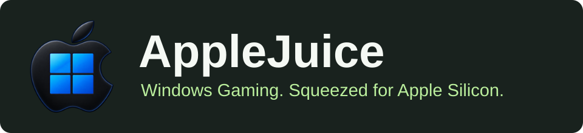
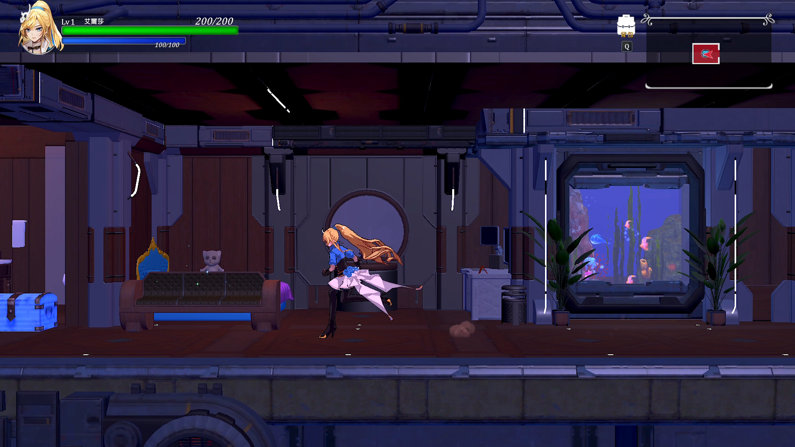
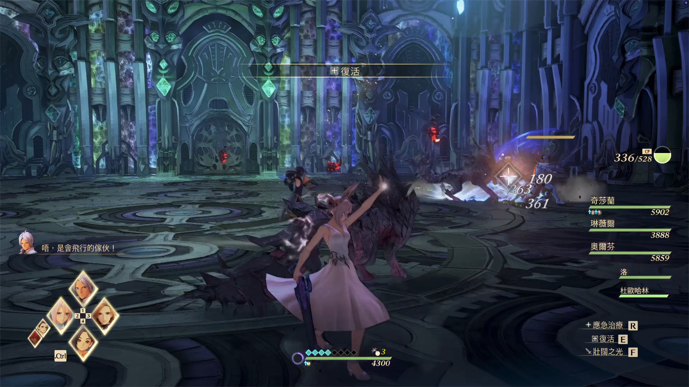
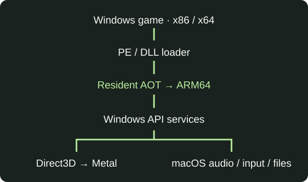

 &nbsp; [English](README.md) · [繁體中文](README.zh-TW.md) · [日本語](README.ja.md) · [한국어](README.ko.md)

# AppleJuice

AppleJuice는 무료로 사용할 수 있으며 소스 코드도 공개되어 있습니다. Apple Silicon Mac에서 지원되는 Windows 게임을 실행하세요. AppleJuice는 자체 CPU 변환기로 x86/x64 코드를 실행하고 Direct3D 그래픽을 Metal로 변환합니다.

**[Mac용 다운로드](https://github.com/VaderChen/AppleJuice/releases/latest)** · [릴리스 노트](https://github.com/VaderChen/AppleJuice/releases) · **[게임 호환성](https://vaderchen.github.io/AppleJuice/tested/?lang=ko)** · [빠른 시작](#start) · [기술 안내서](docs/product/guide.ko.md) · [실제 플레이 영상](#games)

[☕ Buy Me a Coffee](https://buymeacoffee.com/vaderchen)

   

## 빠른 시작

Apple Silicon · macOS 13 이상. 배포 앱에 런타임이 포함되어 있습니다.

1. 릴리스 페이지에서 arm64 DMG를 내려받아 Finder에서 열고 AppleJuice.app을 응용 프로그램 폴더로 드래그하세요.
2. AppleJuice에서 ‘EXE 추가’를 눌러 게임을 선택하세요. 작업 폴더와 드라이브 매핑을 설정하고 저장에 필요한 쓰기 권한을 허용한 뒤 재생 버튼을 누르세요.

[설치 및 문제 해결](docs/product/install.md) · [Steam 설치 영상 보기](https://vaderchen.github.io/AppleJuice/?lang=ko#steam-install)

## 실제 플레이 영상

**[플레이 영상 보기](docs/media/gameplay/applejuice-gameplay.mp4)** · 0:00 Steam 라이브러리에서 실행

두 게임의 플레이 장면은 Apple M4 Pro, 통합 메모리 64 GiB, macOS 27.2.1, AppleJuice 0.26.1126(빌드 727)에서 녹화했습니다. 두 게임 모두 D3D11을 사용합니다. 게임 출력과 무음 영상은 1920 × 1080이며 런처의 MetalFX 업스케일링과 프레임 보간은 껐습니다.

| 0:12 · 프런티어 헌터: 엘사의 운명의 바퀴 | 0:44 · 테일즈 오브 어라이즈 |
|---|---|
|  |  |
| Steam 15701452 · CPU 2코어 | Steam 12823607 · CPU 4코어 |

## 게임 호환성

<!-- compatibility:start -->

**테스트한 게임 · 46** (2026-11-26) · 별도 집계 도구 · 5

-  원활 · 30
-  원활 (MetalFX) · 5
-  저효율 · 7
-  실행 가능 · 2
-  미작동·작업 중 · 2

<!-- compatibility:end -->

"원활 (MetalFX)"는 Launcher의 프레임 보간 또는 2배 확대(MetalFX)를 켜면 원활 기준을 충족한다는 뜻이며, 끄면 저효율에 해당합니다.

"원활"은 50 FPS를 안정적으로 초과하거나 프로그램 자체의 프레임률 상한에 도달한 경우를 뜻합니다.

실측 기록은 당시 버전과 설정 기준이며, 전체 게임 진행, 다른 버전 또는 모든 설정에서의 동작을 의미하지 않습니다.

[게임 호환성 ↗](https://vaderchen.github.io/AppleJuice/tested/?lang=ko) · [게임 호환성 제보](https://github.com/VaderChen/AppleJuice/issues/new?template=game.md)

## 아키텍처

상주 AOT는 게스트 명령을 ARM64 코드로 변환하여 상주 워커에서 실행합니다. 런처에서는 게임별 CPU 수를 설정할 수 있습니다. Direct3D 9~12의 지원 범위는 서로 다르며 D3D12는 부분 지원입니다.

MetalFX 2배 업스케일링과 HRTF 헤드폰 믹싱을 선택할 수 있습니다. 프레임 보간에는 macOS 26 이상과 지원 하드웨어가 필요합니다. 표시 프레임이 늘어나도 게임 자체의 업데이트 속도는 그대로입니다.

[기술 안내서](docs/product/guide.ko.md) · [PE → ARM64 / Direct3D → Metal](https://vaderchen.github.io/AppleJuice/architecture/?lang=ko) · [벤치마크](https://vaderchen.github.io/AppleJuice/geekbench7/?lang=ko)

## 개발 방향

Windows API 지원을 확대하고 게임 호환성과 성능을 개선합니다.

자체 소스 공개 라이선스는 비판매 목적의 이용, 수정 및 무료 배포를 허용합니다. 판매와 유료 서비스에는 제한이 있습니다.

[Support](SUPPORT.md) · [Contributing](CONTRIBUTING.md) · [License](LICENSE.ko.md) · [Third-party notices](THIRD-PARTY-NOTICES.md)

게임에는 각 배급사의 라이선스가 적용됩니다. AppleJuice는 Apple 및 Microsoft와 독립된 프로젝트입니다.
