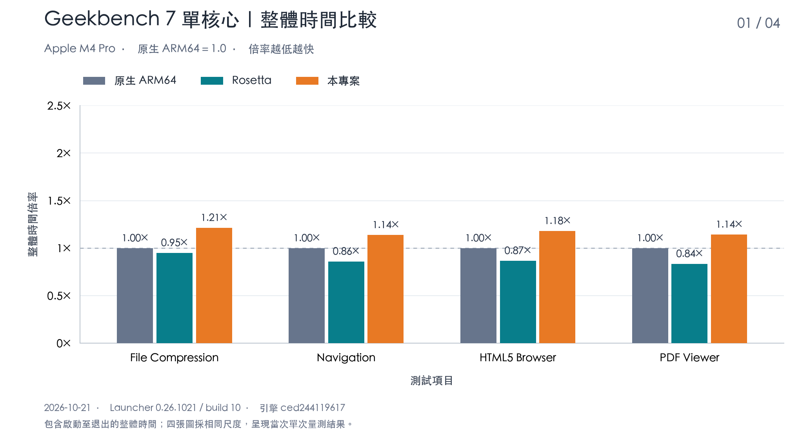
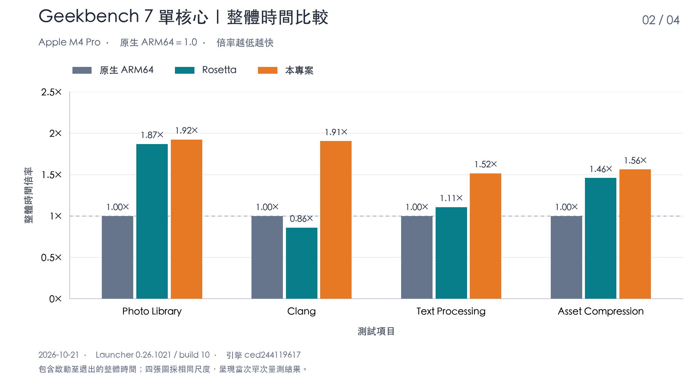
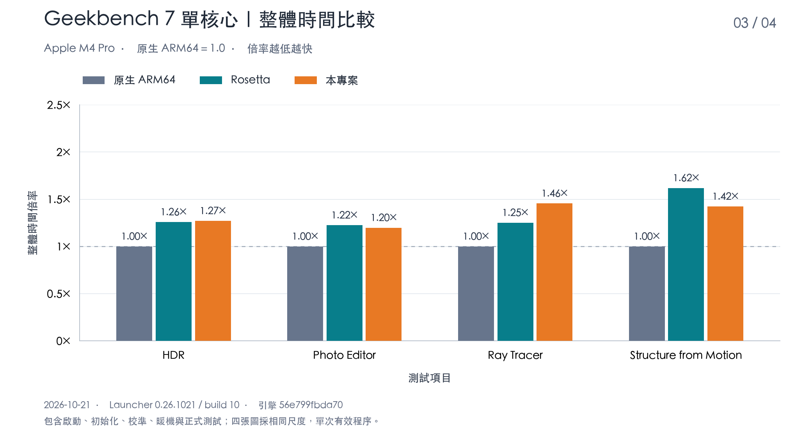
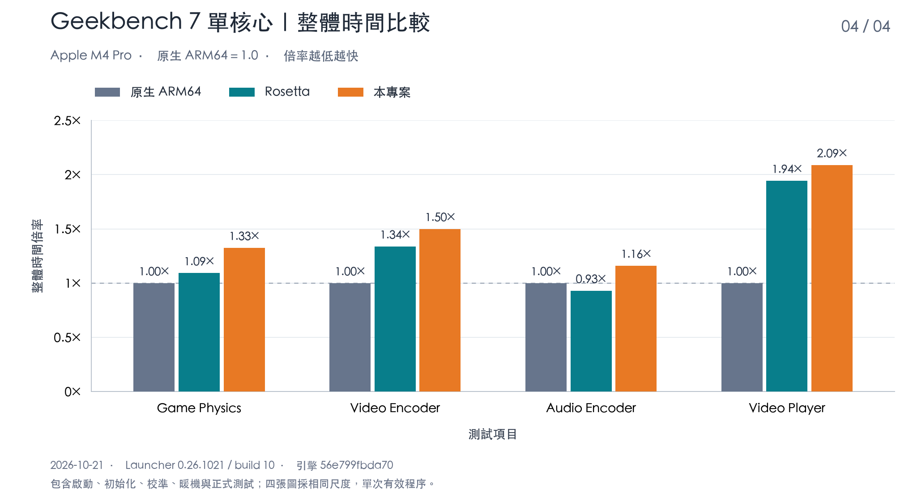

# AppleJuice

[繁體中文](README.md) · [English](README.en.md) · [日本語](README.ja.md) · [한국어](README.ko.md)

在 Apple Silicon Mac 上執行 Windows 程式的相容性專案，包含 **Win64 Launcher** 圖形啟動器與 **x64arm** 命令列程式。AppleJuice 提供 PE／DLL 載入與 Windows 相容服務，並將視窗、繪圖、音訊及輸入接到 macOS 原生介面與 Metal。

儲存庫隨附完整的 `x64kernel/` 靜態 SDK；一般建置不需要核心來源。核心另由 AppleJuiceKernel 提供。靜態連結後的執行檔與 Launcher 套件均屬 AppleJuice 可發布範圍，散布時須保留適用授權。

目前維護 resident AOT 的單核與多核執行路徑。**LLVM 執行後端與舊 JIT 已廢棄，保留但不再維護。** `--backend jit` 是既有介面名稱，預設仍選擇 resident AOT。

## 專案目標與特色

- **不需要 Windows 系統檔案**：目標是在無須安裝 Windows 或提供 Windows 系統 DLL 的情況下執行支援的程式。應用程式及其附帶相依元件由使用者準備。
- **優先使用原生 ARM64 指令**：在維持 x86／x64 指令語義與程式行為正確的前提下，盡量使用 Apple Silicon 原生 ARM64 與 NEON 向量運算。
- **運用原生硬體加速**：圖形與 GPU 運算優先使用 Metal，影片等工作負載盡量使用 macOS 原生框架與可用的硬體加速。

## Geekbench 7 單核心整體時間

2026-10-21 於 Apple M4 Pro、64 GiB 記憶體、macOS 27.0.1 測試 Geekbench 7.0.0 Pro（build 703423）的 16 個單核心測項。AppleJuice 使用 Launcher 0.26.1021（build 10，引擎 `ced244119617`），16 項皆使用同一成品。

**各測項以自己的原生 ARM64 整體時間定為 1.0，倍率越低越快。** 整體時間從程序啟動量到結束，包含初始化、校準、暖機、正式測試及程序內結果寫入；不計入量測工具準備輸入、等待空閒與退出後清理的時間。四張圖採相同 Y 軸尺度，每張呈現四個測項。

AppleJuice 執行 Windows x86_64 版本，Rosetta 執行 macOS x86_64 版本，原生執行 macOS ARM64 版本。圖表比較各測項單次執行的整體時間，呈現當時測試環境下的表現。









## 開始使用

準備 Apple Silicon Mac、Xcode Command Line Tools、CMake 3.24+、Ninja、Python 3、Perl、make、Go 1.23+ 與 MinGW x64 GCC（`x86_64-w64-mingw32-gcc`）。前端資源已隨附，一般建置不需 Node.js；首次 Go 建置需要網路連線或 module 快取。

在儲存庫根目錄執行，或在 Finder 雙擊 `run.command`：

```sh
./run.command
```

完成後開啟 `build/launcher/Win64 Launcher.app`。按「加入 EXE」，選取自行準備的 Windows 程式，設定工作資料夾、命令列、磁碟映射與寫入權限，再按播放圖示。文字程式使用內嵌終端，視窗程式開啟獨立視窗。

## 自行編譯

```sh
cmake --preset release
cmake --build --preset release --target x64arm --parallel 4
./build/release/x64arm doctor
python3 scripts/build_launcher.py --jobs 4
```

前三行建置並檢查 CLI；最後一行建置並封裝 Launcher。保留隨附 SDK 的完整標頭、靜態函式庫、CMake 設定及授權，勿混用不同版本。固定第三方來源與授權亦隨附於儲存庫。

## 文件與相容性

[開始使用](docs/getting-started.md) · [Launcher 操作](docs/launcher.md) · [建置與封裝](docs/build-and-release.md) · [執行與相容性](docs/realworld-support.md) · [GPU 記憶體](docs/gpu-memory.md) · [Geekbench 測試方式](docs/geekbench7-single-core.md) · [文件導覽](docs/README.md)

x64 OpenCL 與 Vulkan 分別使用 macOS OpenCL.framework 與 Vulkan loader／MoltenVK；需求與限制見 [OpenCL／Vulkan](docs/opencl-vulkan-support.md)。

### Direct3D 9

提供 D3D9／D3D9Ex 裝置、紋理與緩衝區、固定功能與可程式化繪圖、交換鏈及 Metal 呈現。特殊格式、裝置能力與渲染狀態組合仍有相容性邊界。

### Direct3D 10／10.1

提供 D3D10／D3D10.1 裝置、資源、著色器、繪圖與 DXGI 交換鏈，連接 Metal。裝置建立成功或版本號不代表所有功能、格式均可使用。

### Direct3D 11

提供裝置與 context、資源與 view、DXBC 著色器轉譯、Draw／Dispatch 及 DXGI 呈現，包含圖形與 GPU 運算。進階功能、格式與擴充介面仍須依程式需求確認；feature level 不代表完整 11.x 相容。

### Direct3D 12

提供裝置、命令佇列／清單、資源與描述元、根簽章、繪圖／運算、fence 與 DXGI 呈現的功能子集，透過 Metal 執行。已有間接命令與 Bundle 路徑；DXR、Mesh Shader、Work Graph 等進階功能不在完整相容承諾內。

### x86（32 位元 Windows）

除了 x86_64（64 位元），亦可載入 x86 PE32 EXE 與相符 DLL。32／64 位元程式預設均使用 resident AOT；附帶 DLL 須與 EXE 位元數相同，同一程序不能混載 32／64 位元 DLL。x86 的 API 與圖形涵蓋範圍不保證與 x64 完全相同，也不代表完整 WOW64、16 位元程式、核心驅動程式或 DRM 均可使用。

詳細範圍與使用建議見 [Direct3D 與 x86 相容性](docs/direct3d-and-x86.md)。

AppleJuice 持續開發中，完整 Windows、所有程式及所有 API 參數組合並未全面支援。成功載入或顯示視窗不代表完整應用程式均可使用。磁碟映射不是完整 OS 沙箱；啟用的服務可能存取映射檔案或使用網路。請只執行信任的程式，並依需要設定存取權限。

儲存庫包含 `src/`、`include/`、`launcher/`、`cmake/`、必要建置腳本、`third_party/`、`x64kernel/` 與使用文件。

## 授權

Copyright (C) 2026 VaderChen.

AppleJuice（包含 x64arm 引擎與 Win64 Launcher 的自有內容）採[原始碼公開・禁止商業販售授權](LICENSE.md)。允許非販售的使用、修改與免費分享，包含公司內部自用；禁止販售、付費代管／SaaS、收費服務及付費產品整合。一般員工薪資不視為販售；藉軟體提供取得廣告、導購佣金或資料交易收入亦受限制。有相關商業需求時，請與著作權人討論另行書面授權，洽詢本身不構成授權。

靜態連結 AppleJuiceKernel 後的執行檔與 Launcher 套件亦屬於 AppleJuice 的可發布範圍，隨成品保留核心及第三方授權聲明；拆分儲存庫不改變既有授權限制。

此為自訂的原始碼公開授權，不屬於 OSI 定義的開源授權。四語 README 為摘要，以繁體中文完整授權為準。第三方元件、另附授權的內容與外部 Windows 程式仍依各自授權處理。

完整授權：[繁體中文](LICENSE.md) · [English](LICENSE.en.md) · [日本語](LICENSE.ja.md) · [한국어](LICENSE.ko.md)

[商業販售政策](COMMERCIAL-LICENSE.md) · [授權適用範圍與來源](docs/licensing.md) · [第三方授權索引](THIRD-PARTY-NOTICES.md)
