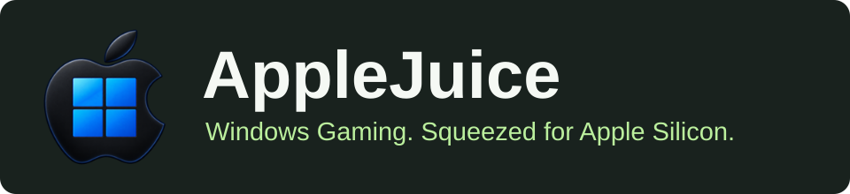
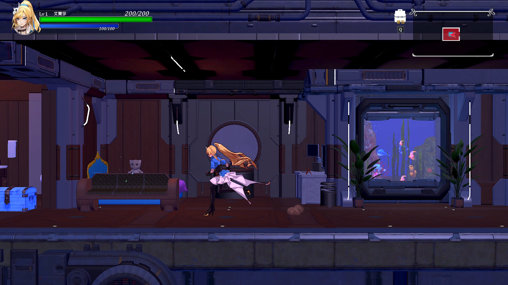
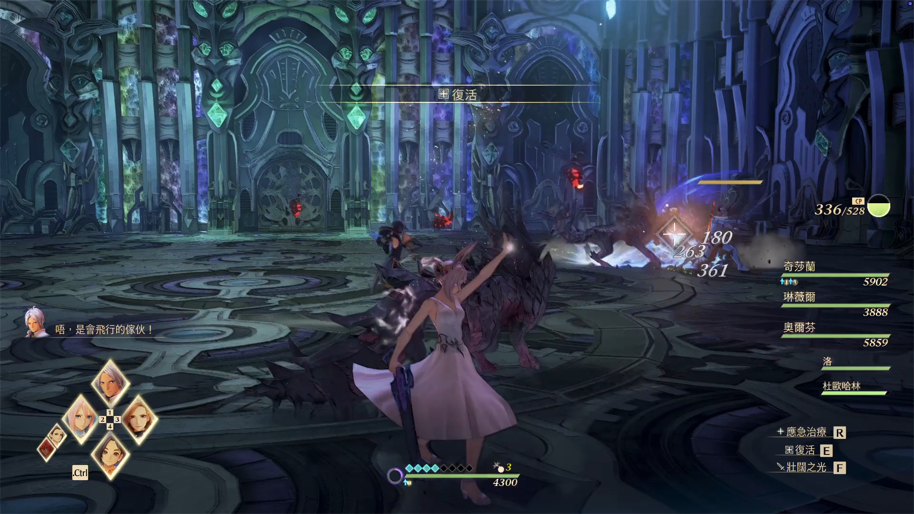
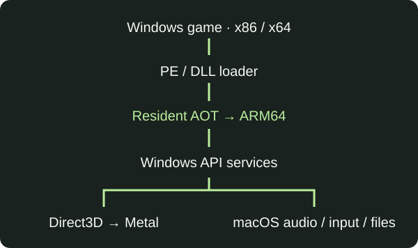

 &nbsp; [English](README.md) · [繁體中文](README.zh-TW.md) · [日本語](README.ja.md) · [한국어](README.ko.md)

# AppleJuice

AppleJuice is a free-to-use Windows gaming compatibility runtime for Apple Silicon. Its source code is publicly available. Play supported Windows games on your Mac with AppleJuice’s own CPU translator and Direct3D-to-Metal graphics.

**[Download for Mac](https://github.com/VaderChen/AppleJuice/releases/latest)** · [Release notes](https://github.com/VaderChen/AppleJuice/releases) · **[Game compatibility](https://vaderchen.github.io/AppleJuice/tested/?lang=en)** · [Quick start](#start) · [Technical guide](docs/product/guide.en.md) · [Gameplay showcase](#games)

[☕ Buy Me a Coffee](https://buymeacoffee.com/vaderchen)

   

## Quick start

Apple Silicon · macOS 13 or later. The packaged app includes the runtime.

1. Open the release and download the arm64 DMG. Open it in Finder and drag AppleJuice.app to Applications.
2. Launch AppleJuice, choose **Add EXE**, then select your copy of the Windows game. Set its working directory and drive mappings. Enable write access where the game needs to save, then press Play.

[Installation & troubleshooting](docs/product/install.md) · [Watch Steam install in AppleJuice](https://vaderchen.github.io/AppleJuice/?lang=en#steam-install)

## Gameplay showcase

**[Watch the gameplay capture](docs/media/gameplay/applejuice-gameplay.mp4)** · 0:00 Steam Library launch

Both gameplay chapters were recorded on an Apple M4 Pro with 64 GiB of unified memory, macOS 27.2.1 and AppleJuice 0.26.1126 (build 727). Both games use D3D11. The game output and silent recording are 1920 × 1080, with Launcher MetalFX upscaling and frame interpolation off.

| 0:12 · Frontier Hunter: Erza’s Wheel of Fortune | 0:44 · Tales of Arise |
|---|---|
|  |  |
| Steam 15701452 · 2 CPU cores | Steam 12823607 · 4 CPU cores |

## Game compatibility

<!-- compatibility:start -->

**Tested games · 46** (2026-11-26) · Tools listed separately · 5

-  Works well · 30
-  Works well (MetalFX) · 5
-  Slow · 7
-  Launches · 2
-  Not working (WIP) · 2

<!-- compatibility:end -->

"Works well (MetalFX)" means the game meets the works-well criterion with the Launcher's frame interpolation or 2× upscaling (MetalFX) turned on; without them it is rated Slow.

"Works well" requires sustained performance above 50 FPS or reaching the application's own frame-rate cap.

Test records reflect the version and settings at the time and do not establish that complete gameplay, other versions or all settings work.

[Game compatibility ↗](https://vaderchen.github.io/AppleJuice/tested/?lang=en) · [Report a game](https://github.com/VaderChen/AppleJuice/issues/new?template=game.md)

## Architecture

Resident AOT translates guest code into ARM64 regions and runs them on resident workers. The native Launcher provides per-game CPU settings. Direct3D 9–12 paths have different coverage; D3D12 support is partial.

Optional output features include 2× MetalFX upscaling and HRTF headphone mixing. Frame interpolation requires macOS 26 or later and supported hardware. It increases displayed frames while the game keeps its own update rate.

[Technical guide](docs/product/guide.en.md) · [PE → ARM64 / Direct3D → Metal](https://vaderchen.github.io/AppleJuice/architecture/?lang=en) · [Performance & methodology](docs/product/benchmark.md)

## Development priorities

Expand Windows API support and improve game compatibility and performance.

Free non-sale use, modification and free redistribution are permitted under the custom source-available license. Sales and paid services are restricted.

[Support](SUPPORT.md) · [Contributing](CONTRIBUTING.md) · [License](LICENSE.en.md) · [Third-party notices](THIRD-PARTY-NOTICES.md)

Windows games remain subject to their publishers’ licenses. AppleJuice is independent of Apple and Microsoft.
