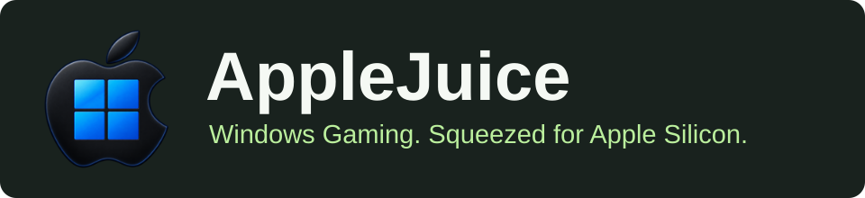
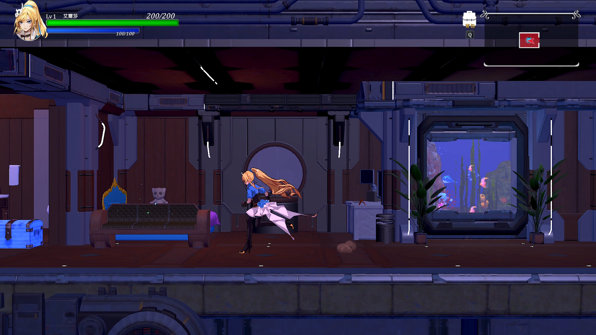
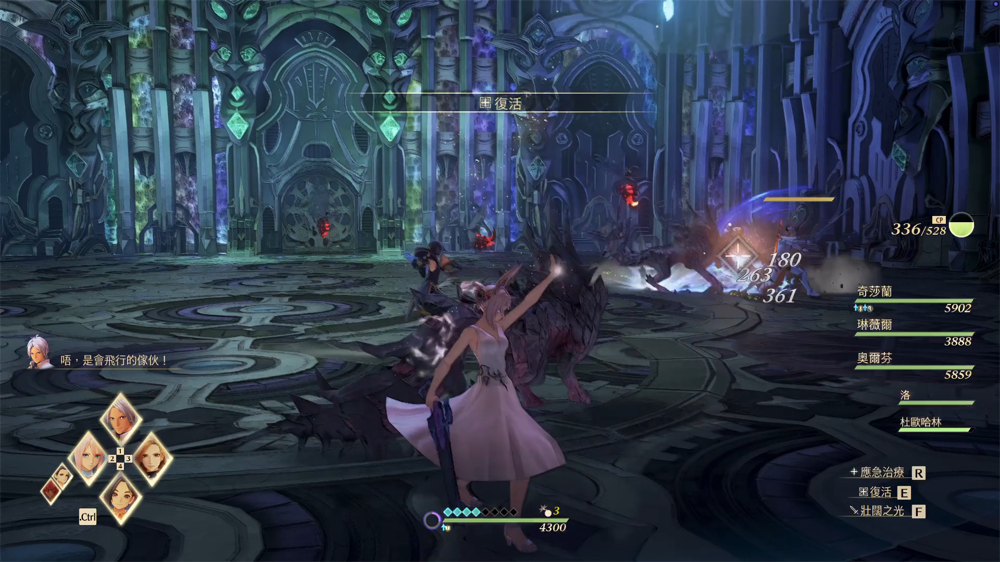
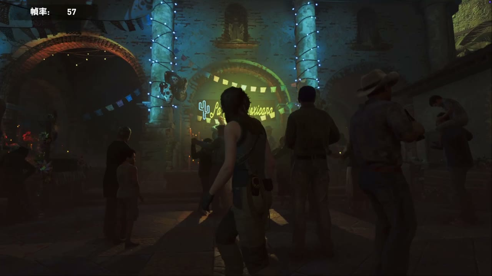
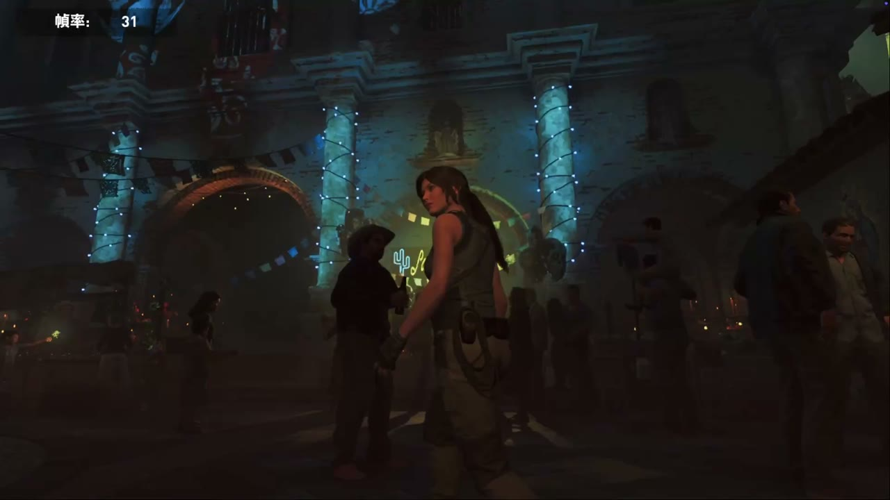
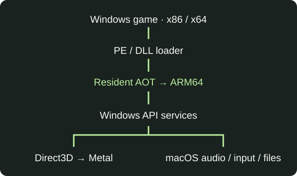

 &nbsp; [English](README.md) · [繁體中文](README.zh-TW.md) · [日本語](README.ja.md) · [한국어](README.ko.md)

# AppleJuice

AppleJuice 可免費使用，原始碼公開。在 Apple Silicon Mac 上玩支援的 Windows 遊戲。AppleJuice 以自研 CPU 轉譯器執行 x86／x64 程式，並將 Direct3D 繪圖接到 Metal。

**[下載 Mac 版](https://github.com/VaderChen/AppleJuice/releases/latest)** · [版本說明](https://github.com/VaderChen/AppleJuice/releases) · **[遊戲相容性](https://vaderchen.github.io/AppleJuice/tested/?lang=zh)** · [快速開始](#start) · [技術手冊](docs/product/guide.zh.md) · [實機遊玩展示](#games)

[☕ Buy Me a Coffee](https://buymeacoffee.com/vaderchen)

   

## 快速開始

Apple Silicon · macOS 13 以上。下載版已內含執行環境。

1. 前往發行頁下載 arm64 DMG，在 Finder 開啟後將 AppleJuice.app 拖到「應用程式」。
2. 啟動 AppleJuice，按「加入 EXE」選取自己的遊戲，設定工作目錄與磁碟映射，開放存檔所需的寫入權限，再按播放。

[安裝與疑難排解](docs/product/install.md) · [觀看 Steam 安裝實錄](https://vaderchen.github.io/AppleJuice/?lang=zh#steam-install)

## 實機遊玩展示

**[觀看實機錄影](https://vaderchen.github.io/AppleJuice/?lang=zh#gameplay)** · 0:00 從 Steam 收藏庫啟動

錄製環境為 Apple M4 Pro、64 GiB 統一記憶體、macOS 27.2.1，解析度 1920 × 1080。《邊境獵人》使用 AppleJuice 0.26.1126 build 727 與 2 個 CPU 核心，其餘遊戲使用 build 1536 與 4 個 CPU 核心。只有《古墓奇兵：暗影》的最後一段開啟畫面內插。

| 0:12 · 邊境獵人：艾爾莎的命運之輪 | 0:44 · 破曉傳奇 |
|---|---|
|  |  |
| Steam 15701452 · 2 個 CPU 核心 | D3D11 · 關閉 MetalFX |

| [1:24 · 巫師 3](https://vaderchen.github.io/AppleJuice/media/gameplay/applejuice-gameplay.mp4#t=83.933) | [1:54 · 古墓奇兵：暗影 · 關閉內插](https://vaderchen.github.io/AppleJuice/media/gameplay/applejuice-gameplay.mp4#t=113.933) | [2:34 · 古墓奇兵：暗影 · 開啟內插](https://vaderchen.github.io/AppleJuice/media/gameplay/applejuice-gameplay.mp4#t=154) |
|---|---|---|
|  |  |  |

## 遊戲相容性

<!-- compatibility:start -->

**實測遊戲 · 46** (2026-11-26) · 另列工具 · 5

-  運作良好 · 30
-  運作良好 (MetalFX) · 5
-  效率不高 · 7
-  可開啟 · 2
-  無法運作、處理中 · 2

<!-- compatibility:end -->

「運作良好 (MetalFX)」表示開啟 Launcher 的畫面內插或 2 倍放大（MetalFX）後達到運作良好標準；未開啟時仍屬效率不高。

「運作良好」須穩定超過 50 FPS，或達到程式本身的幀率上限。

實測紀錄依當時版本與設定，不代表完整遊戲流程、其他版本或所有設定均可使用。

[遊戲相容性 ↗](https://vaderchen.github.io/AppleJuice/tested/?lang=zh) · [回報遊戲](https://github.com/VaderChen/AppleJuice/issues/new?template=game.md)

## 技術架構

resident AOT 將客體指令轉成 ARM64 區段，交由常駐 worker 執行。原生 Launcher 可按遊戲設定 CPU 核心數。Direct3D 9–12 各路徑涵蓋程度不同，D3D12 為部分支援。

可選用 MetalFX 兩倍放大及 HRTF 耳機混音。畫面內插需要 macOS 26 以上與支援的硬體；遊戲更新率與內插後的顯示幀率分開計算。

[技術手冊](docs/product/guide.zh.md) · [PE → ARM64 / Direct3D → Metal](https://vaderchen.github.io/AppleJuice/architecture/?lang=zh) · [效能測試](https://vaderchen.github.io/AppleJuice/geekbench7/?lang=zh)

## 開發方向

擴充 Windows API 支援，改善遊戲相容性與執行效能。

自訂原始碼可用授權允許非銷售使用、修改與免費散布，並限制販售及付費服務。

[Support](SUPPORT.md) · [Contributing](CONTRIBUTING.md) · [License](LICENSE.md) · [Third-party notices](THIRD-PARTY-NOTICES.md)

遊戲各自適用發行商授權。AppleJuice 為獨立專案，與 Apple 及 Microsoft 無隸屬關係。
