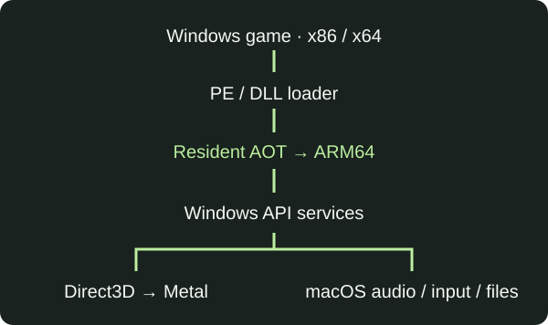

# From a Windows executable to an Apple Silicon frame

The Launcher chooses the EXE, working directory, virtual drives and guest CPU settings. The runtime loads the PE image and its DLLs, maps sections and resolves imports against guest libraries or AppleJuice services.

**CPU translation.** Guest instructions are decoded into operations the kernel can lower to native ARM64 instructions. Translated regions execute on resident workers. Multiple guest threads can use the CPU count selected for that application. The historic CLI backend name `jit` selects resident AOT. The Launcher and compatibility layer link the separately maintained kernel's static SDK.

**Reuse and pretranslation.** The kernel can retain translations and save SMAP data for reuse. The CLI's `precompile-pe` prepares eligible regions without executing the game. Background translation can prepare work before a worker needs it. Cache reuse depends on the image and compatible translation state. The shared decode cache and background job counters are visible in the [SDK interface](../../x64kernel/include/x64arm/aot_engine.hpp).

**Host services.** Guest imports can call project-owned Windows API implementations. Graphics services translate supported resources, shader operations and draws to Metal. D3D9–12 coverage varies by API, shader and resource format; D3D12 support is partial. Audio preserves stereo and can render multichannel sound as binaural stereo. The Launcher uses Go and a native WKWebView interface.

**Presentation.** Spatial MetalFX upscaling enlarges a completed frame. VideoToolbox interpolation constructs intermediate display frames on eligible systems. Neither changes the guest simulation rate. In-game XeSS can use the separate temporal MetalFX path.

AppleJuice combines its own CPU translation, Windows services and graphics mappings in one runtime. Its execution model does not require installing a Windows guest OS. See the [technical guide](guide.en.md) for individual Direct3D versions and supported paths.
