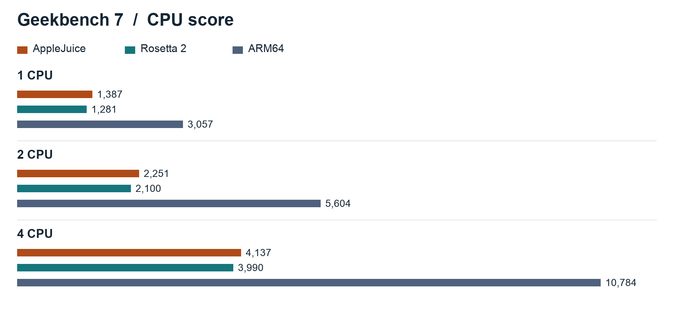

# Reading the CPU scores

**November 25, 2026 · Apple M4 Pro · 64 GB · macOS 27.2.1**

| Workload threads | AppleJuice, Windows x86_64 | Rosetta 2, macOS x86_64 | Native, macOS ARM64 |
|---:|---:|---:|---:|
| 1 | 1,387 | 1,281 | 3,057 |
| 2 | 2,251 | 2,100 | 5,604 |
| 4 | 4,137 | 3,990 | 10,784 |

Geekbench 7.0.0 Pro (703423) exported these scores. AppleJuice used Launcher 0.26.1125 build 1313. Each configuration contributed one full run on the same machine, with one warm-up and three scored iterations per workload. The single-thread group covers 16 workloads. Each multi-thread group covers eight. Higher scores indicate more work per unit time under Geekbench’s scoring method.

The Windows and macOS runs use different executables. This sample measures those configurations together, including platform differences. It cannot isolate translation overhead, quantify run-to-run variation or predict game FPS. Comparable cold/warm launch times, memory, frame times and 1% lows are outside this dataset.

[Interactive workload breakdown and charts](https://vaderchen.github.io/AppleJuice/geekbench7/?lang=en) · [Reproduction guide](../geekbench7-single-core.md) · [Recorded scores and test configuration](guide.en.md)
